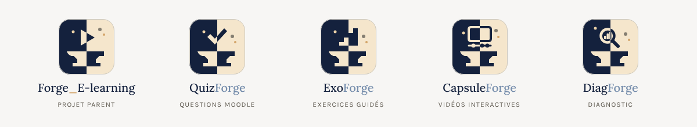
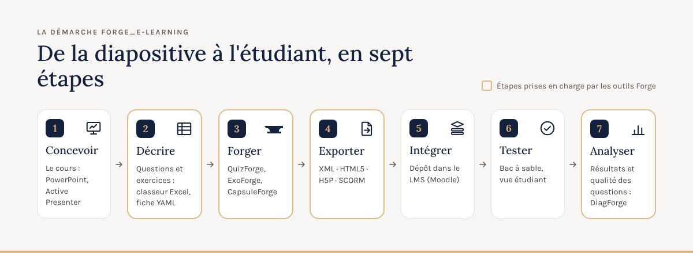
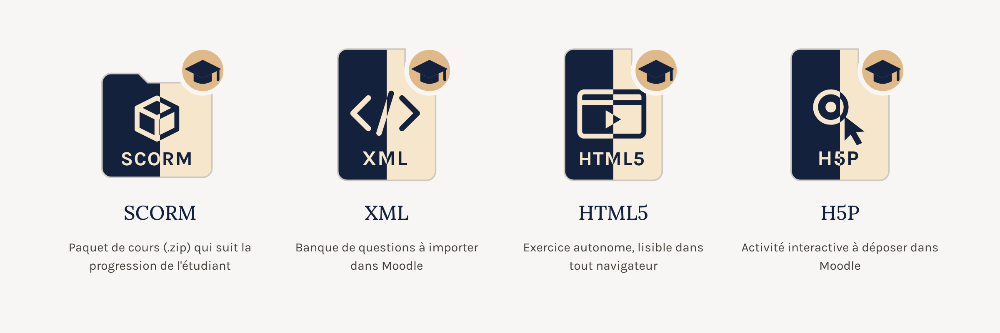

<picture>
  <source media="(prefers-color-scheme: dark)" srcset="_static/identite/bandeaux/forge_e-learning_bandeau_nuit.png">
  
</picture>

# Forge E-Learning

Des outils libres pour passer d'un cours existant à des activités en ligne : questions Moodle, exercices guidés autonomes, chapitres de cours interactifs, puis l'analyse des résultats des étudiants. Chaque outil part d'un fichier simple (classeur Excel, fiche YAML, diaporama PowerPoint) que l'enseignant garde sous la main, relit et corrige ; la sortie (Moodle XML, page HTML5, paquet SCORM) est reconstruite à chaque fois.

Écrits pour l'enseignement de la mécanique et des mathématiques en école d'ingénieurs, les outils ne sont pas propres à ces disciplines.

> **Version 0.3** publiée ; **0.4** en préparation. Les outils servent déjà en cours ; leur maturité est inégale : voir l'état ci-dessous et le [journal des versions](CHANGELOG.md).

## Les outils

<picture>
  <source media="(prefers-color-scheme: dark)" srcset="_static/identite/bandeaux/famille_forge_bandeau_nuit.png">
  
</picture>

| Outil | Rôle | Mode d'emploi |
| --- | --- | --- |
| QuizForge | classeur Excel → questions Moodle (XML, GIFT) : huit types de questions, questions sur image, rétroactions, erreurs types visées par les leurres, contrôle de l'écriture | [outils/quizforge](outils/quizforge/README.md) |
| ExoForge | fiche YAML → exercice guidé autonome (HTML5 et SCORM 1.2) : données tirées, formules LaTeX, diagnostic des erreurs, graphiques, audio | [outils/exoforge](outils/exoforge/README.md) |
| CapsuleForge | diaporama narré, vidéo ou capture → chapitre de cours interactif (lecteur HTML, SCORM 2004 ou 1.2) : parcours, sous-titres, questions, exercices, traduction, voix de synthèse | [outils/capsuleforge](outils/capsuleforge/README.md) |
| DiagForge | exports Moodle → bilan : classeur, fiche du professeur, images pour les étudiants, qualité des questions, erreurs types, tirage | [outils/diagforge](outils/diagforge/README.md) |

<picture>
  <source media="(prefers-color-scheme: dark)" srcset="_static/identite/formats/bandeaux/demarche_bandeau_nuit.png">
  
</picture>

La première étape, concevoir le cours, reste celle de l'enseignant : Forge part du cours existant et ne le fournit pas. Les outils produisent les formats que Moodle sait accueillir :

<picture>
  <source media="(prefers-color-scheme: dark)" srcset="_static/identite/formats/formats_nuit.png">
  
</picture>

QuizForge produit le Moodle XML (et le GIFT), ExoForge la page HTML5 et le paquet SCORM 1.2, CapsuleForge le lecteur HTML et les paquets SCORM 2004 et 1.2 ; l'export H5P est prévu. Les outils partagent un style ([style/](style/README.md)) et des profils d'établissement ([profils/](profils/README.md)) : couleurs par rôle, polices, barème Moodle.

## Une bibliographie derrière chaque réglage

Les réglages des outils s'appuient sur une lecture de la recherche en éducation, rangée dans [reference/](reference/README.md) : **9 axes**, **250 références** ([forge.bib](reference/forge.bib), importable dans Zotero), **197 fiches de lecture** en français et **602 règles** adressées aux outils.

Une fiche résume un article lu en texte complet (question, public, méthode, résultats chiffrés, lecture critique), puis donne les règles qu'il justifie pour un outil, chacune avec un **niveau de preuve** (de A, preuve solide et répliquée, à D, indice faible) et une **transférabilité** à l'enseignement scientifique en école d'ingénieurs. Méthode : [fiches_methode.md](reference/fiches_methode.md).

| Axe | Question pour les outils | Fiches | Règles |
| --- | --- | ---: | ---: |
| [A — Tests et rétroaction](reference/A_tests_retroaction/README.md) | quel retour, quand, combien d'essais ? | 19 | 58 |
| [B — Conception des QCM](reference/B_conception_qcm/README.md) | comment écrire de bons leurres ? | 25 | 77 |
| [C — Analyse d'items](reference/C_analyse_items/README.md) | quels indicateurs, quels seuils ? | 10 | 25 |
| [D — Exemples guidés et guidage](reference/D_exemples_guidage/README.md) | combien d'aide, comment la retirer ? | 27 | 58 |
| [E — Multimédia](reference/E_multimedia/README.md) | audio, apparitions, découpage | 31 | 99 |
| [F — Vidéo interactive](reference/F_video_interactive/README.md) | quand interrompre une vidéo par une question ? | 20 | 66 |
| [G — Restitution aux étudiants](reference/G_restitution/README.md) | que montrer à l'étudiant de ses résultats ? | 16 | 33 |
| [H — Spécificités STEM](reference/H_specificites_stem/README.md) | paramètres aléatoires, erreurs types en mécanique | 29 | 121 |
| [I — Accessibilité](reference/I_accessibilite/README.md) | lisibilité, dyslexie, audio | 20 | 65 |

## État des outils (version 0.3)

| Outil | Version | Essayé en conditions réelles | Livré, pas encore essayé | Manque |
| --- | --- | --- | --- | --- |
| AtelierForge | 0.5 | les outils lancés par boutons sous Windows ; cours, déclinaisons, éditions ; versions et registre ; carte « 6. PDF » ; « Oublier » dans Réglages | — | essai hors Windows |
| QuizForge | 0.9 | tous les types de questions dans Moodle ; `valider` ; barème « équilibré » ; quiz de séance | rappel des réglages Moodle conseillés | catalogue d'erreurs types par domaine ; export H5P |
| ExoForge | 0.8 | quatre exercices validés ; paquet SCORM 1.2 dans Moodle ; exercice traduit dans un chapitre | graphiques dans les étapes sur les exercices anciens | fonction Φ ; reprise d'un exercice interrompu |
| CapsuleForge | 0.9 | chapitre pilote complet jusqu'aux paquets SCORM 2004 et 1.2 reçus par Moodle ; chapitre bilingue (sous-titres, questions, exercice) et voix de synthèse ; vidéo ; enregistrement d'écran ; capsule habillée pour plusieurs écoles ; diaporama sans voix ; vidéo insérée dans le diaporama ; fin du pas réglable ; PDF à part, en versions | contrôle des chevauchements après le modèle ou la traduction ; caméo dans le lecteur ; remarques de vérification dans la relecture | partir d'une intention (plan, squelette) ; simulation ActivePresenter ; éditeur d'assemblage ; export H5P |
| DiagForge | 0.6 | bilan sur le bac à sable Moodle et des promotions fictives | commande `diagforge.py` ; tirage, équité, rétention ; erreurs types | essai sur une vraie promotion ; restitution aux étudiants ; traces SCORM |
| Style, profils | — | profils `Delattre` et `Ecole1` | — | thème modifiable dans CapsuleForge |
| Bibliographie | — | 9 axes, 197 fiches | — | règles de restitution (axe G) à appliquer dans DiagForge |

Limite connue : Moodle ne prend pas officiellement en charge SCORM 2004 ([FAQ SCORM de Moodle](https://docs.moodle.org/en/SCORM_FAQ)) ; les paquets de CapsuleForge y ont fonctionné, comme ses paquets SCORM 1.2 (`--scorm-version 1.2`), plus sûrs pour d'autres plateformes. Détail outil par outil : page « État des outils » du site.

## Installation

Il faut Python 3.10 ou plus récent. Le plus simple est [uv](https://docs.astral.sh/uv/), qui installe Python et les bibliothèques dans un environnement propre au dossier.

```bash
git clone https://github.com/Benoit2lattre/Forge_E-Learning.git
cd Forge_E-Learning
uv venv                                   # crée .venv (et installe Python si besoin)
uv pip install -r requirements.txt
```

Les commandes des modes d'emploi s'écrivent `python …` et se lancent depuis le dossier du dépôt. Activez l'environnement d'abord (`.venv\Scripts\activate` sous Windows, `source .venv/bin/activate` sous macOS et Linux), ou remplacez `python` par `uv run python`.

Vérification :

```bash
python scripts/quizforge/quizforge.py profils
python scripts/exoforge/build.py outils/exoforge/exemples/premier_exercice
```

La seconde commande produit `dist/exoforge/premier_exercice/index.html`, à ouvrir dans le navigateur.

Sous Windows, un double-clic sur `Forge.bat`, à la racine du dépôt, ouvre **AtelierForge** : une page dans le navigateur qui lance les outils par boutons et listes (questions, exercices, capsules, bilans et cours ; voir son [mode d'emploi](outils/atelier/README.md)). Un double-clic sur `scripts/quizforge/QuizForge.bat` ouvre l'assistant de QuizForge, sans ligne de commande ; `scripts/capsuleforge/CapsuleForge.bat` fait de même pour CapsuleForge.

### Tester sans Moodle d'établissement

Le bac à sable public de Moodle, [sandbox.moodledemo.net](https://sandbox.moodledemo.net), est remis à zéro toutes les heures. Les comptes de démonstration (`teacher`, `student`…) sont affichés sur sa page d'accueil. Il suffit pour importer des questions, déposer un paquet SCORM, passer le test en étudiant et télécharger les exports du bilan ; les captures des modes d'emploi en viennent.


## Le site de documentation

Le site (Jupyter Book) réunit l'accueil, la page « Pourquoi de tels outils ? », l'état des outils, les modes d'emploi, la bibliographie, les skills, les prochaines étapes et la référence du code. Il se construit depuis la racine du dépôt :

```bash
uv pip install -r site/requirements.txt
jupyter-book build . --config site/_config.yml --toc site/_toc.yml --path-output site
```

Sortie : `site/_build/html/index.html`. Une fois la publication activée, le site construit est aussi disponible seul, sans le code, sur la branche `gh-pages` :

```bash
git clone --branch gh-pages --single-branch --depth 1 https://github.com/Benoit2lattre/Forge_E-Learning.git forge-site
```

## Organisation

| Dossier | Contenu | En ligne |
| --- | --- | --- |
| `scripts/<outil>/` | code de chaque outil ; `scripts/commun/` : partagé | oui |
| `outils/<outil>/` | mode d'emploi et exemples | oui |
| `donnees/` | données d'exemple (fictives) | oui |
| `style/` | éléments de style génériques (rôles de couleur, CSS, LaTeX) | oui |
| `profils/` | adaptation du style à une école | oui |
| `reference/` | bibliographie des méthodes | oui |
| `skills/` | skills d'aide autour de Forge (assistant d'IA) | oui |
| `site/` | configuration et pages du site de documentation | oui |
| `_static/` | logos, icônes, bandeaux et captures d'écran | oui |
| `data/`, `_legacy/`, `_brouillons/`, `_pilotage/` | données personnelles (classeurs, exports, médias, profils privés), anciens fichiers, essais, plans de travail | non (`.gitignore`) |
| `dist/`, `site/_build/` | sorties construites (exercices, paquets SCORM, site) | non |

**Pour contribuer** : `git config core.hooksPath .githooks` active le contrôle avant commit : `scripts/commun/verifier_depot.py` refuse les fichiers des dossiers locaux, les fichiers de plus de 5 Mo et les adresses de courriel réelles.

## Licences

- Code (`scripts/`) : GNU GPL v3, voir `LICENSE`.
- Documentation, exemples, bibliographie, cours et site : CC BY-NC-SA 4.0, voir `LICENSE-contenus`.
- Bibliothèque embarquée : MathJax (licence Apache 2.0, `scripts/exoforge/moteur/vendor/MATHJAX_LICENSE`), copiée dans les exercices et paquets produits.

## Auteur

Benoit Delattre, enseignant-chercheur en mécanique. L'assistant d'IA [Claude](https://claude.ai) (Anthropic) a été utilisé pour l'écriture du code, la lecture et la synthèse de la bibliographie, l'édition et la relecture ; les choix pédagogiques et la validation des outils en cours relèvent de l'auteur.
