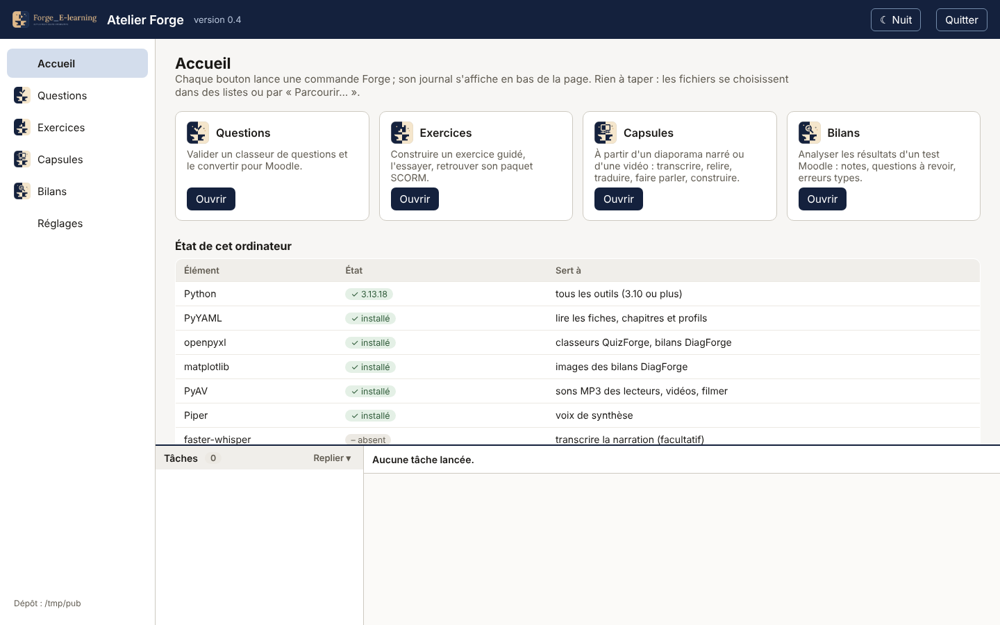
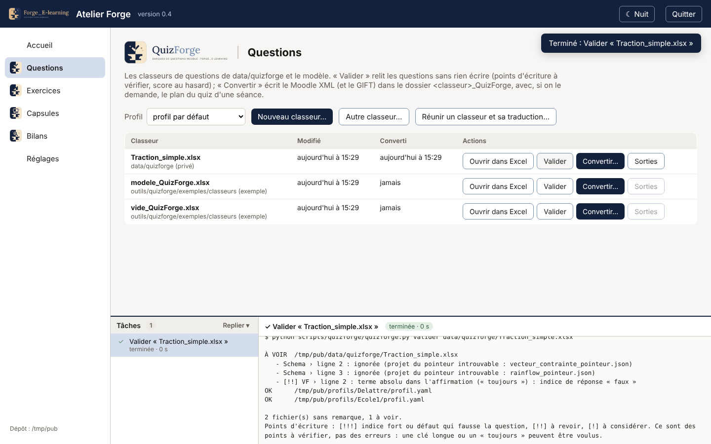
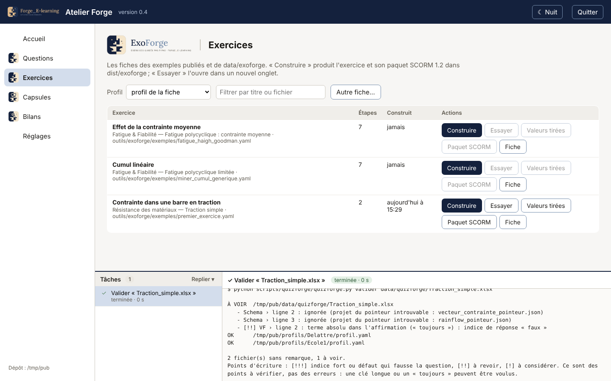
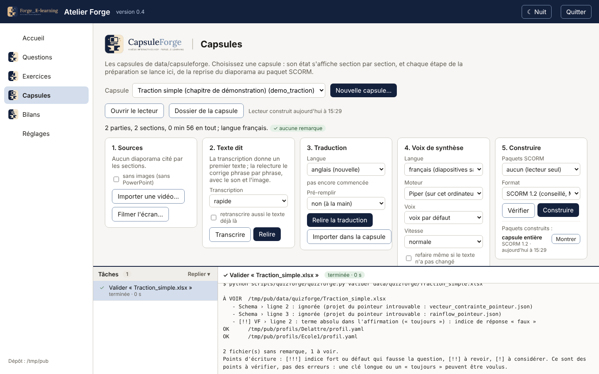
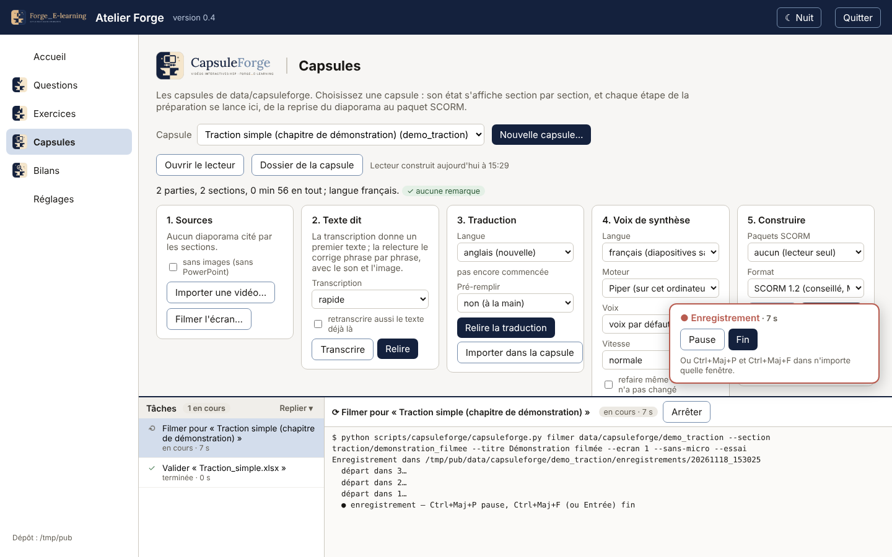
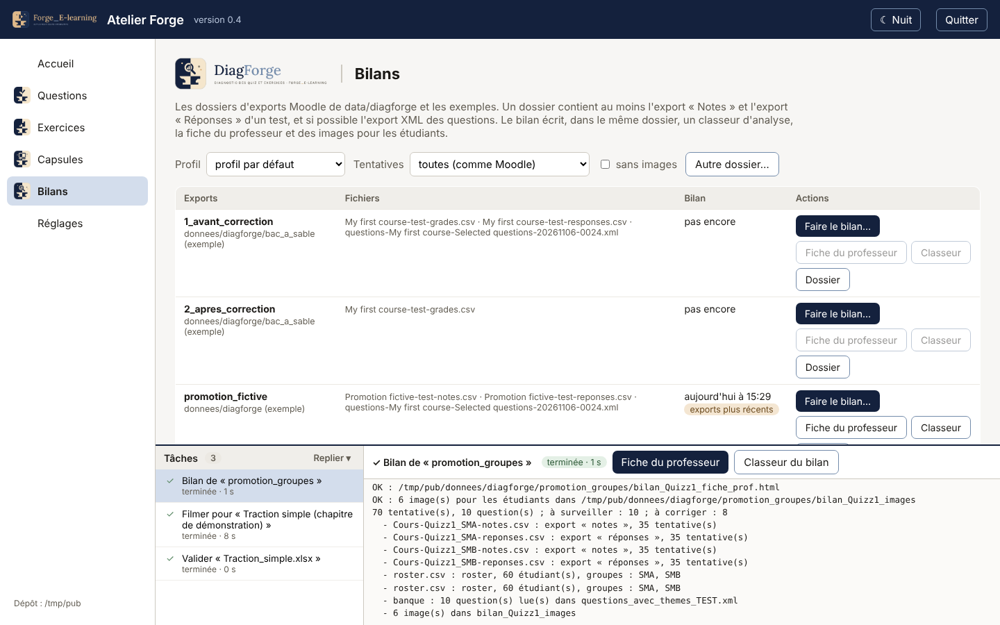
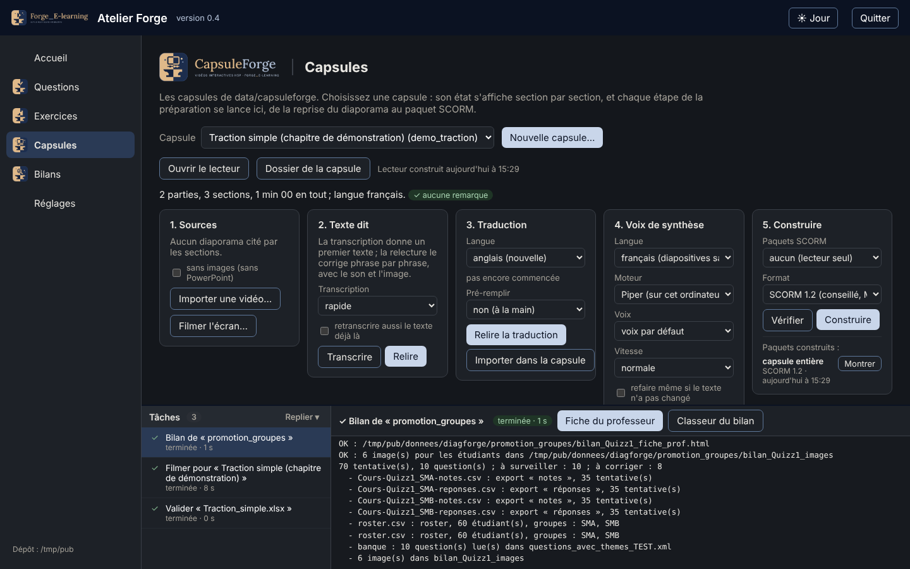

# Atelier Forge

L'Atelier Forge lance toute la suite Forge depuis une page du navigateur, par boutons et listes : rien à taper, ni commande ni chemin. Il ne refait aucun calcul : chaque bouton lance la commande de l'outil (QuizForge, ExoForge, CapsuleForge, DiagForge), et son journal s'affiche en bas de la page.

Statut : version 0.4, essayée sous Windows sur les cours de l'auteur. Les commandes restent utilisables seules (voir le mode d'emploi de chaque outil).

## Lancer et fermer

Double-clic sur `Forge.bat`, à la racine du dépôt : une fenêtre de commande s'ouvre (la laisser ouverte) et la page s'affiche dans le navigateur. Pour fermer : bouton « Quitter », ou fermer l'onglet (l'atelier s'arrête quelques secondes après, sauf si une tâche tourne encore : il attend sa fin).

Sans le fichier `.bat` : `python scripts/forge/forge.py` (options `--port`, `--sans-navigateur`).

L'**accueil** montre l'état de l'ordinateur : Python, les modules utiles (et ce que chacun permet), PowerPoint, les voix de synthèse téléchargées. Un élément facultatif absent n'empêche que ce qu'il sert à faire.

Les écrans suivent l'ordre des outils, du plus simple au plus complet : Questions, Exercices, Capsules (qui utilise les deux premiers), Bilans (qui analyse les trois autres), puis Réglages. Le **panneau des tâches**, en bas, est commun à tous les écrans : chaque tâche lancée y garde son journal, son état, sa durée, un bouton « Arrêter » tant qu'elle tourne et, à la fin, les boutons utiles (essayer l'exercice, ouvrir le lecteur, la fiche du professeur, montrer le paquet SCORM…). Toutes les tâches sont aussi notées dans `data/_atelier/journal.jsonl`.

« Montrer » ouvre l'explorateur sur un fichier ; « Ouvrir » ouvre un fichier avec son programme (Excel, navigateur). La fenêtre est mise au premier plan ; le bouton reste grisé quelques secondes, pour ne pas en ouvrir plusieurs. Les fichiers se choisissent par « Parcourir… », qui ouvre le dialogue de fichiers de Windows (il peut s'ouvrir derrière le navigateur).

## Questions (QuizForge)

Les classeurs de `data/quizforge`, ceux ajoutés par « Autre classeur… » et les classeurs d'exemple. Pour chacun : Ouvrir dans Excel, Valider (points d'écriture à vérifier, score au hasard ; rien n'est écrit), Convertir… (catégorie Moodle, nom, tags, Moodle XML ou GIFT, réparation des textes, plan du quiz d'une séance avec l'effectif de la promotion), Sorties. « Nouveau classeur… » crée un classeur à partir du modèle (avec exemples ou vide) et l'ouvre dans Excel ; « Réunir un classeur et sa traduction… » écrit un classeur bilingue.

## Exercices (ExoForge)

Les fiches des exemples et de `data/exoforge`. Construire (avec le profil de la fiche ou un autre) produit l'exercice et son paquet SCORM 1.2 ; Essayer l'ouvre avec des valeurs fixes, Valeurs tirées avec de nouvelles valeurs à chaque ouverture ; « fiche modifiée depuis » signale une construction en retard.

## Capsules (CapsuleForge)

On choisit la capsule ; son résumé (parties, sections, durée, langues, remarques de vérification) et cinq étapes s'affichent :

1. **Sources** : reprendre chaque diaporama cité par les sections (avec PowerPoint pour les images, ou sans) — l'atelier le retrouve dans `data/capsuleforge` ou dans le dossier `e_learning` voisin du dépôt, sinon on le désigne une fois ; importer une vidéo ; filmer l'écran.
2. **Texte dit** : transcrire, puis relire phrase par phrase avec le son et l'image (l'écran de relecture s'ouvre dans un onglet).
3. **Traduction** : langue, pré-remplissage (à la main, Argos hors ligne, DeepL), relire la traduction, l'importer dans la capsule.
4. **Voix de synthèse** : langue, moteur, voix, vitesse.
5. **Construire** : vérifier, construire le lecteur avec ou sans paquets SCORM (une capsule, une par partie, ou les deux ; SCORM 1.2 conseillé pour Moodle).

Le tableau des sections, sous les étapes, donne l'état de chacune : diapositives reprises, images, texte dit, relu, texte et voix par langue, questions. Cocher des sections limite la transcription et la voix à celles-ci.

**Nouvelle capsule…** part d'un diaporama (plan proposé : une partie par section PowerPoint, des sections de quelques minutes d'après le minutage, titrées par leur première diapositive ; la reprise du diaporama peut s'enchaîner), d'une manipulation enregistrée dans un logiciel, d'un projet ActivePresenter, ou de rien (pour une vidéo ou un film d'écran ensuite). Une capsule écrite pour l'ancien lecteur se met à jour d'un bouton ; elle garde l'accès à l'ancien éditeur.

**Filmer l'écran…** demande l'écran, le micro, la caméra (médaillon) et la section, puis filme après un compte à rebours de 3 s. Le panneau d'enregistrement donne Pause ou Reprendre et Fin ; dans n'importe quelle fenêtre, Ctrl+Maj+P et Ctrl+Maj+F font de même. À la fin, la vidéo est importée dans la section, découpée en pas aux silences. Le bouton **Tester** à côté du micro l'écoute 4 s et dit si la voix est assez forte (sinon : rapprocher le micro ou monter son volume dans Windows ; une voix faible est de toute façon relevée à l'import). Si une caméra a été filmée, la carte « 5. Construire » propose la place, la taille et la forme du médaillon (caméo) ; l'élève peut le masquer dans le lecteur.

## Bilans (DiagForge)

Les dossiers d'exports Moodle de `data/diagforge` et les exemples. « Faire le bilan… » reprend l'export XML des questions et la liste des étudiants trouvés dans le dossier (ou choisis), et accepte d'autres exports du même test ; la tentative retenue, le profil et « sans images » se règlent dans la barre de l'écran. À la fin, la fiche du professeur s'ouvre ; le classeur d'analyse est à côté.

## Réglages et apparence

L'écran Réglages garde dans `data/_atelier/reglages.json` : l'apparence (jour, nuit ou comme Windows ; aussi par le bouton ☾ / ☀ en haut de la page), le profil d'établissement proposé d'office, les classeurs ajoutés et les chemins des diaporamas retrouvés.

## Sécurité

Le serveur n'écoute que sur cet ordinateur (127.0.0.1, port 8770 ou le suivant libre), refuse les requêtes venues d'un autre site et demande un jeton tiré au lancement. Il ne lance que des actions connues, avec des options vérifiées : jamais une ligne de commande libre. Code : [`scripts/forge/`](https://github.com/Benoit2lattre/Forge_E-Learning/tree/main/scripts/forge).
