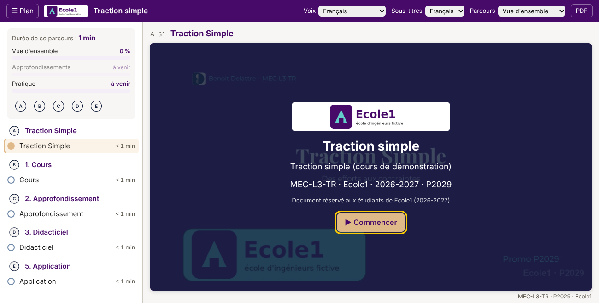
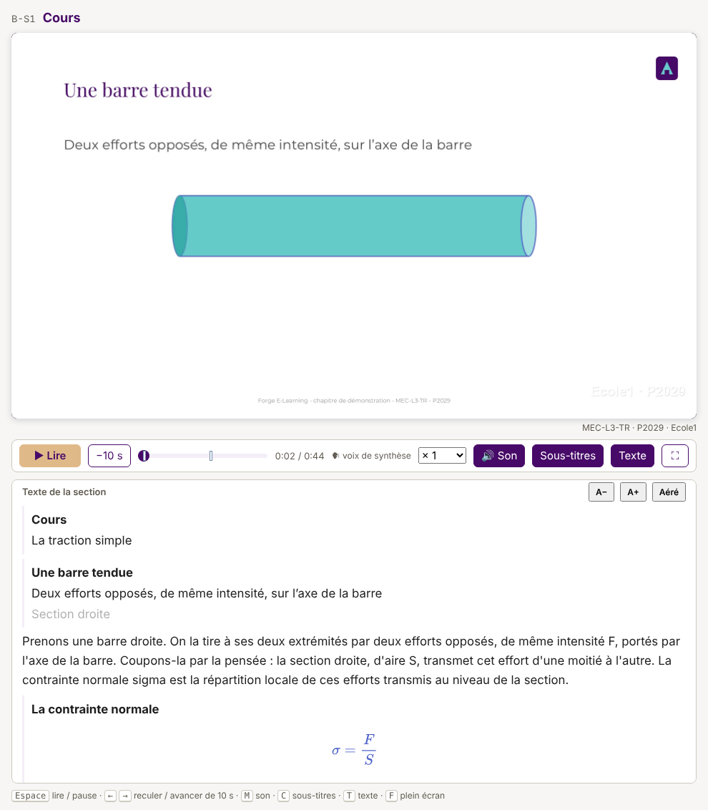
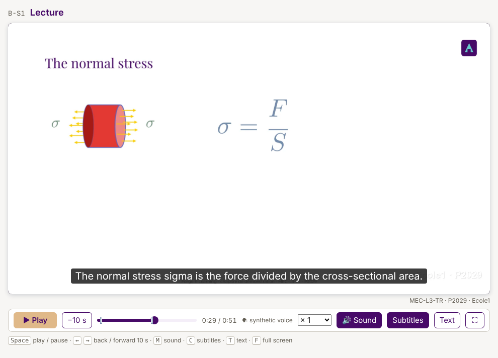
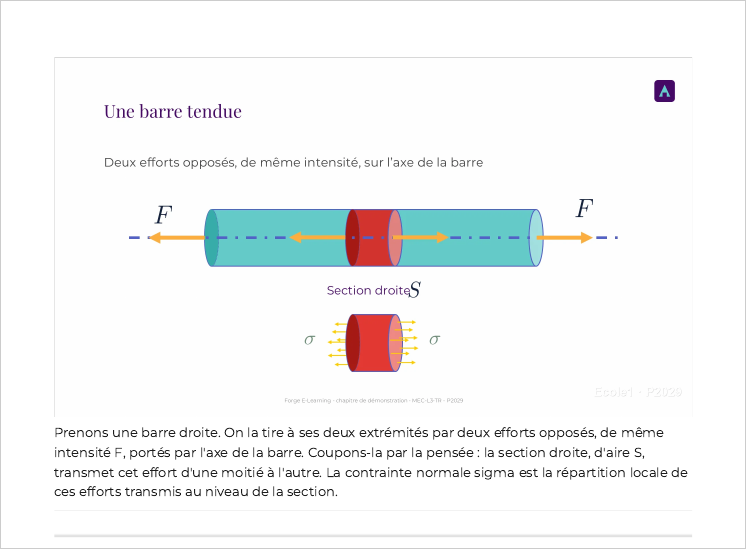
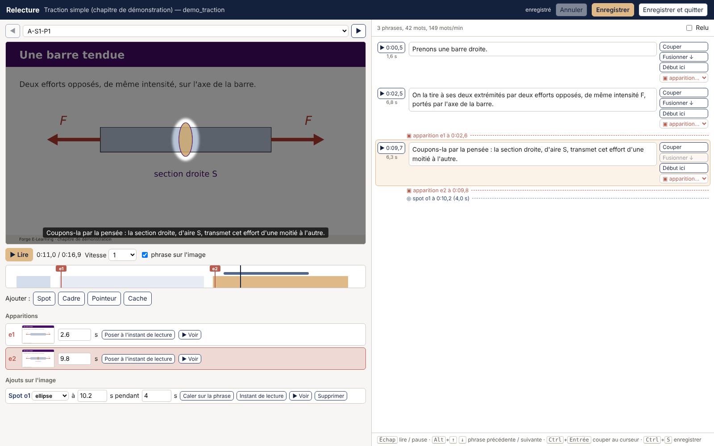
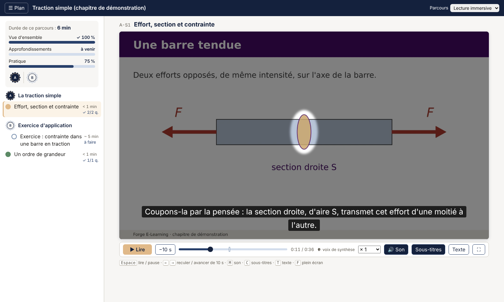
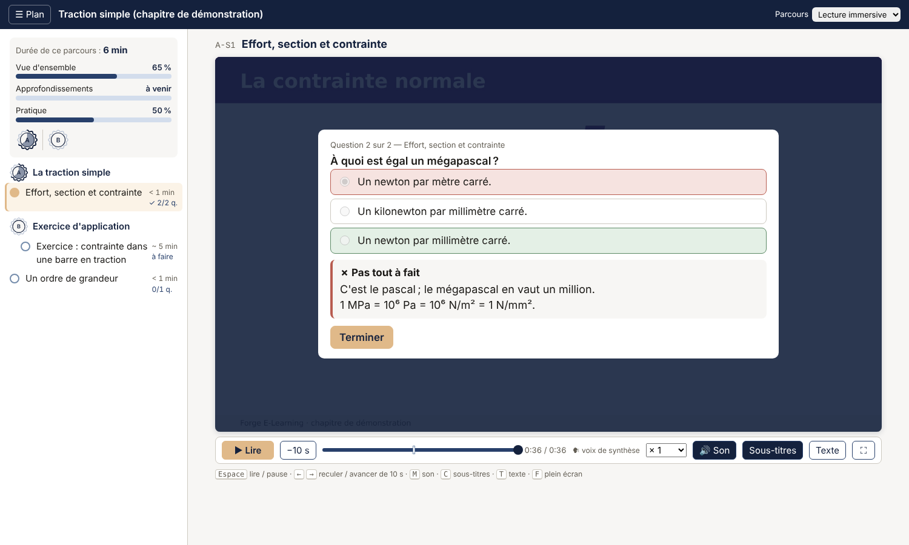
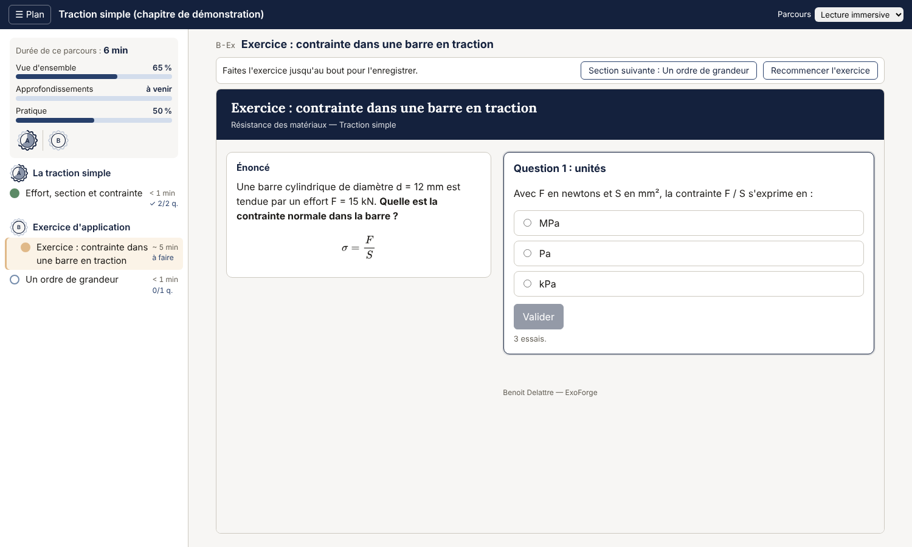
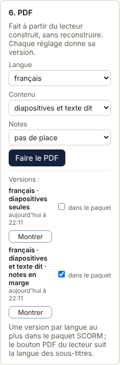

# CapsuleForge

<p></p>

CapsuleForge produit des **capsules** : des cours et des didacticiels interactifs, décrits dans un fichier texte (`chapitre.yaml`, voir [FORMAT.md](FORMAT.md)). Une capsule part d'un diaporama PowerPoint narré, d'une vidéo, d'un enregistrement d'écran ou d'une manipulation enregistrée dans un logiciel (FreeCAD, ABAQUS, Excel…), et peut mêler ces sources ; elle reçoit des questions QuizForge, des exercices ExoForge, des sous-titres, une traduction et une voix de synthèse. Le fichier texte est la seule référence : on le relit, on le corrige, et le lecteur HTML (ou le paquet SCORM) est reconstruit à chaque fois.

Une capsule est découpée en parties et en sections de quelques minutes, avec plusieurs parcours, des questions en fin de section et des exercices ; elle se lit dans un lecteur HTML ou se dépose dans Moodle en paquet SCORM. Un didacticiel montre une manipulation puis la fait faire (« Regarder » puis « À vous ») : il remplace le mode « simulation interactive » d'ActivePresenter sans son défaut principal (une diapositive par action, à la durée de l'enregistrement). Les premiers didacticiels étaient écrits pour un ancien lecteur (`capsule.yaml`) ; AtelierForge les met à jour pour le lecteur actuel (dernière partie de cette page).

Statut : outil en développement, utilisé sur un chapitre pilote. Essayés en conditions réelles : reprise d'un diaporama narré, transcription, relecture, lecteur de chapitre, questions et exercices, paquets SCORM 2004 et 1.2 dans Moodle, traduction et voix de synthèse, import de vidéo, enregistrement d'écran, et une capsule habillée pour plusieurs écoles (charte, modèle PowerPoint, variantes, texte et diapositives traduits, PDF, versions par édition). Pas encore : caméo dans le lecteur, relecture d'un diaporama sans voix, éditeur d'assemblage, simulation ActivePresenter dans le chapitre, export H5P. L'état détaillé est sur la page « État des outils » du site.

Dans cette page, `capsuleforge …` abrège `python scripts/capsuleforge/capsuleforge.py …`, lancé depuis le dossier du dépôt. Un nom seul (`fiabilite`) désigne le dossier `data/capsuleforge/fiabilite/`. Sous Windows, le plus simple est **AtelierForge** (double-clic sur `Forge.bat`, à la racine du dépôt), écran « Capsules » : on choisit la capsule, son état s'affiche section par section (diapositives reprises, images, texte dit, relu, traduction, voix, questions) et chaque étape se lance par un bouton (reprendre un diaporama, importer une vidéo, transcrire, relire, traduire, faire la voix, vérifier, construire avec ou sans paquets SCORM), sans ligne de commande. Un double-clic sur `scripts/capsuleforge/CapsuleForge.bat` ouvre aussi un menu qui pose les questions une à une (enregistrer, construire, vérifier, reprendre un diaporama, relire…), sans ligne de commande.

## Une capsule, plusieurs écoles

Un même cours se donne dans plusieurs écoles, parcours ou années. CapsuleForge le prépare une fois, **nu** (sans rien qui désigne un établissement), puis le **rhabille** pour chaque édition d'un cours (école, déclinaison, année) au moment de construire. Le diaporama de l'auteur n'est jamais modifié.

1. **Dans PowerPoint**, ce qui dépend de l'édition se prépare sur les diapositives : formes nommées `cf édition` (montrées dans les éditions) ou `cf édition ecole1` (pour cette école seulement), champs `{cours}`, `{code}`, `{promo}`… dans le texte (voir « Habiller dans PowerPoint » plus bas).
2. **Reprise** (`capsuleforge pptx`) : les images de la capsule nue (formes d'édition cachées, champs vides, masque de l'auteur caché) et le texte de chaque diapositive, gardé comme texte.
3. **Relecture** : chaque phrase dite peut être réservée à un public, retirée pour lui ou remplacée (bouton « Public ») : un renvoi au reste du cursus n'est dit que là où il a un sens.
4. **Traduction** : le texte dit, les titres et le texte des diapositives ; les diapositives elles-mêmes sont réexportées dans la langue.
5. **Construction pour une édition** (`construire --cours`, ou un cours choisi dans AtelierForge) : charte et logo de l'école, écran d'accueil, pied de page, filigrane si l'édition le demande ; PowerPoint applique le **modèle de l'école** (`.potx` de son profil) et remplit les champs ; à la demande, un **PDF** à imprimer. Le paquet SCORM et le PDF sont rangés comme version de l'édition.









Un modèle d'école change les polices et les couleurs des diapositives : un texte peut s'élargir et toucher une équation ou un schéma restés en place. À regarder dans le lecteur, diapositive par diapositive, à la première construction d'une édition.

## Préparer une capsule

### Chaîne

```
capsuleforge nouvelle cours --titre … --diaporama cours.pptx   crée la capsule : plan proposé (parties = sections PowerPoint, sections de quelques minutes)
chapitre.yaml                                       plan : parties, sections, renvois aux diapositives (proposé par nouvelle, corrigé à la main ou avec un assistant d'IA)
capsuleforge plan fiabilite                         plan par parcours, durées
capsuleforge pptx cours.pptx --chapitre fiabilite   diapositives → pas : images, sons, apparitions, annotations « cf … » (Windows, PowerPoint)
capsuleforge transcrire fiabilite                   premier jet du texte dit (Whisper, sur cet ordinateur)
capsuleforge relire fiabilite                       relecture : texte, phrases, apparitions, spots, cadres, caches
capsuleforge construire fiabilite --scorm parties   lecteur HTML et paquets SCORM pour Moodle
capsuleforge traduire / voix                        traduction, sous-titres, voix de synthèse
```

Des vidéos (`video`) et des enregistrements d'écran (`filmer`) entrent dans les mêmes sections que les diapositives.

### Le fichier `chapitre.yaml` : parties, sections, pas

Le chapitre est décrit dans [FORMAT.md](FORMAT.md) : des parties (tronc, annexes, exercices), des sections de 5 à 6 min et des pas qui sont des scènes (fond, objets, gestes attendus, retours), avec plusieurs parcours sur le même contenu (par exemple vue d'ensemble, lecture détaillée, lecture immersive). Une section renvoie aux diapositives qui la composent (`source: {fichier: cours.pptx, diapos: [6, 7]}`) ; un chapitre en cours d'écriture porte `source: {statut: squelette}` (une section encore vide n'est alors qu'un avertissement).

```
capsuleforge plan fiabilite                          plan par parcours : noms (B-S2-P4), durées, annexes, questions
capsuleforge plan fiabilite --parcours immersive
capsuleforge verifier fiabilite                      erreurs et avertissements
```

### Reprendre un diaporama PowerPoint narré

```
capsuleforge pptx Fiabilite.pptx --chapitre fiabilite                # toutes les diapositives citées par le chapitre
capsuleforge pptx Fiabilite.pptx --chapitre fiabilite --diapos 6-12  # seulement celles-ci
```

Chaque diapositive citée par une section devient un pas : image de départ et une image par clic d'animation (produites par PowerPoint lui-même, sous Windows), son de la narration enregistrée dans PowerPoint, durée. Chaque clic devient une apparition. Diapositive enregistrée : les apparitions sont réparties d'abord sur la durée (PowerPoint n'enregistre pas l'instant des clics), puis réglées dans la relecture, et les notes servent de premier texte dit. Diapositive sans enregistrement : les notes deviennent les phrases du texte dit et chaque clic est accroché à sa phrase, à l'endroit de sa balise `[clic]` ou, sans balise, dans l'ordre (voir [Préparer son diaporama pour CapsuleForge](DIAPORAMA.md)). Le texte de la diapositive est gardé comme texte (`texte_diapo` du pas) : titres, paragraphes avec leur niveau, tableaux équations natives de PowerPoint et équations IguanaTeX (en LaTeX), chacun avec le clic à partir duquel il est visible, et les liens hypertextes (cliquables dans le volet « Texte ») ; les annotations « cf … », les images, les pieds de page, les étiquettes d'un seul symbole posées sur un schéma et les numéros de section n'y sont pas. `--sans-images` suffit pour l'ajouter à une capsule déjà reprise. Relancer la commande après une modification du diaporama garde le texte déjà relu, les instants réglés et les ajouts de la relecture. Le journal est écrit dans `pptx_journal.txt` du chapitre et l'ancien chapitre est copié dans `sauvegardes/`. `--sans-images` reprend la structure et les sons sans piloter PowerPoint ; `--largeur` fixe la largeur des images.

Ce qu'un diaporama peut porter (plan, animations, texte dit, balises de calage), degré par degré, et la façon de l'écrire pour que la reprise le comprenne : voir [Préparer son diaporama pour CapsuleForge](DIAPORAMA.md), avec un diaporama d'exemple pour chaque degré.

### Annoter dans PowerPoint (formes « cf … »)

Les spots, cadres et pointeurs se dessinent aussi dans PowerPoint, sur la diapositive : on trace la forme, puis on la renomme dans le volet Sélection (Accueil > Organiser > Volet Sélection) :

| Nom de la forme | Ce qu'elle devient |
| --- | --- |
| `cf spot` | zone éclairée, le reste assombri (rectangle ou ellipse) |
| `cf cadre` | zone entourée (rectangle ou ellipse) |
| `cf cache` | zone masquée jusqu'à un instant réglé dans la relecture ; non repris si un cache de la relecture couvre déjà la zone |
| `cf pointeur` | point lumineux ; tracé en trait ou en forme libre (ligne brisée), il suit ce trajet, du premier point au dernier |

Le nom peut être suivi de ce que l'on veut (`cf pointeur moyennes`). Ces formes ne sont jamais sur les images, et leurs animations éventuelles sont ignorées. `capsuleforge pptx …` les relit à chaque passage : leur forme vient du diaporama, leur instant et leur durée se règlent dans la relecture et sont gardés. Une apparition qui manque se remet comme animation PowerPoint ordinaire, puis on relance `capsuleforge pptx`. Limites : formes hors d'un groupe, sans rotation.

### Habiller dans PowerPoint : formes d'édition et champs

Une capsule reprise d'un diaporama est nue : ses images ne nomment aucun établissement. Ce qui dépend de l'édition se prépare sur les diapositives elles-mêmes, puis est rempli à la construction pour chaque édition (`construire --cours`).

| Dans le diaporama | Capsule nue | Édition |
| --- | --- | --- |
| forme nommée `cf édition` (volet Sélection) | cachée | montrée |
| forme nommée `cf édition ecole1` (ou `cf édition ecole1, aero`) | cachée | montrée seulement pour ce public : l'école du profil ou une variante active |
| forme nommée `cf nu` | montrée | cachée |
| texte `{cours}`, `{code}`, `{bloc}`, `{promo}`, `{annee}`, `{ecole}`, `{enseignant}`, `{declinaison}`, `{capsule}` | vide | valeur de l'édition (`cours.yaml` et profil de l'école) |
| formes du masque (logo, bandeau) et pieds de page sans champ | cachés | cachés |

Exemple : sur la page de titre, un sous-titre `{cours} · {promo}` et un cartouche `cf édition ecole1` avec le logo de l'école ; dans le pied de page, `{code} · {promo}`. Dans la capsule nue, un champ vidé part avec le séparateur voisin (`Benoit Delattre - {code}` devient « Benoit Delattre ») et une forme dont il ne reste que des séparateurs est cachée : ni sous-titre vide ni pied orphelin. Un libellé ne part pas avec son champ (`Promo {promo}` donnerait « Promo ») : une telle forme se nomme `cf édition`. Un champ peut être mis en forme comme le reste du texte, la mise en forme est gardée.

Le masque des diapositives est caché par défaut (« Masquer les graphiques d'arrière-plan » de PowerPoint) : le fond et les couleurs du thème restent, les logos et les mentions qu'il porte disparaissent. Pour un masque neutre à garder partout, écrire dans `chapitre.yaml` :

```yaml
powerpoint:
  masque: garder
```

Les champs écrits dans le masque sont alors remplis aussi.

**Modèle de l'école.** Si le profil de l'école donne un modèle PowerPoint (`habillage: {modele: modele_ecole1.potx}`, voir [Profils d'établissement](../../profils/README.md)), toutes les diapositives de l'édition sont réexportées avec ce modèle appliqué : thème, polices, couleurs et masque de l'école ; les pieds de page de l'auteur restent cachés, ceux qui portent des champs sont remplis. Chaque diapositive garde sa disposition, appariée par son nom ; la construction signale une disposition absente du modèle ou un format différent. Les équations IguanaTeX et les images gardent leurs couleurs d'origine. Sans modèle, l'image d'une édition garde le thème du diaporama.

À la construction d'une édition, seules les diapositives qui portent des formes d'édition ou des champs sont réexportées par PowerPoint (toutes, avec un modèle d'école) ; les autres gardent l'image nue. Ces images sont gardées dans `_editions/` du chapitre (jamais publié) et refaites seulement si le diaporama, l'habillage ou la largeur change. Le diaporama est cherché là où il a été repris (noté dans le chapitre), à côté du chapitre, dans `sources/`, puis parmi les diaporamas retenus par l'atelier. Il faut donc PowerPoint (Windows) la première fois qu'on construit une édition ; ensuite, le cache suffit. `capsuleforge pptx` signale dans son journal les formes d'édition et les champs trouvés sur chaque diapositive.

### Transcrire le texte dit

```
capsuleforge transcrire fiabilite                        # pas qui n'ont pas encore de texte
capsuleforge transcrire fiabilite --modele medium        # plus juste, plus lent
capsuleforge transcrire fiabilite --sections dimensionnement --refaire
```

La narration de chaque pas est transcrite sur cet ordinateur (Whisper, via `faster-whisper` ; rien n'est envoyé en ligne). Le résultat est un premier jet, à corriger dans la relecture : les mots horodatés sont gardés dans `transcriptions/<pas>.json` et servent à placer les phrases dans le temps. Un pas qui a déjà un texte n'est pas retranscrit, sauf avec `--refaire`.

### Relire le texte dit

```
capsuleforge relire fiabilite                  (ou CapsuleForge.bat, choix 7)
```

Ouvre dans le navigateur la diapositive, le son et le texte dit, phrase par phrase. On corrige une phrase en l'écoutant (bouton ▶ de la phrase), on la coupe au curseur (Ctrl+Entrée), on la fusionne avec la suivante, on règle son début sur l'instant de lecture. Les apparitions se posent à l'instant de lecture, au début d'une phrase, ou en faisant glisser leur repère rouge sur la piste. Une apparition est **accrochée à une phrase** : sous l'image, sa ligne indique la phrase, le début ou la fin, et le décalage (−0,4 s par défaut, juste avant d'être nommée) ; « ▣ accrocher… » d'une phrase l'accroche au début de cette phrase. Elle suit alors sa phrase quand la voix change ou qu'une phrase est coupée ou fusionnée ; la poser à la main règle son décalage. « instant fixe » la détache. Le champ **pause** d'une phrase règle le silence après elle (0,4 s par défaut) ; il est rendu par la voix de synthèse. Un pas **sans son** se relit quand même : la lecture est muette et les instants (marqués « ≈ ») sont estimés au débit de la langue, puis remplacés par ceux de la voix quand elle est générée. « Relu » marque le pas comme relu par l'auteur.



Sous la piste, « Ajouter » pose sur l'image ce que le diaporama n'a pas : un **spot** (zone éclairée, le reste assombri), un **cadre**, un **pointeur** (point lumineux) ou un **cache** (zone masquée jusqu'à un instant donné, pour une apparition absente du diaporama). On place le curseur dans une phrase, on choisit le type, on trace sur l'image : l'ajout prend le début et la durée de la phrase. Il se déplace à la souris, se règle dans la liste, se supprime par Suppr.

Touches : Échap lit ou met en pause (même depuis un texte), Alt+↑ ou ↓ joue la phrase voisine, Ctrl+S enregistre. « Enregistrer et quitter » arrête la relecture et libère la fenêtre de commande ; fermer l'onglet a le même effet au bout de quelques secondes.

Les remarques de `verifier` sur le pas ouvert (phrase mal placée dans le temps, phrase après la fin du son, fond ou son introuvable…) s'affichent en haut de la colonne des phrases, et un « ⚠ » marque les pas concernés dans la liste ; elles sont recalculées à chaque enregistrement.

Les phrases horodatées (`phrases` du pas) sont la seule source de la narration et des sous-titres. À la première ouverture, elles sont préparées à partir de la narration et de la transcription ; rien n'est écrit avant « Enregistrer » (l'ancien chapitre est copié dans `sauvegardes/`).

### Importer une vidéo (enregistrement d'écran, export ActivePresenter, clip)

```
capsuleforge video capture.mp4 --chapitre fiabilite --section dimensionnement/approche
capsuleforge video demo.mp4 --chapitre tuto1 --section principale/esquisse --titre "Créer une esquisse"   # nouvelle section
capsuleforge video export_AP.mp4 --chapitre fiabilite --section applications/train --debut 12 --fin 95 --remplacer
capsuleforge video Video_281.MP4 --son audio_284.mp4 --chapitre tuto1 --section principale/abaqus --remplacer   # son à part (ActivePresenter)
```

ActivePresenter range le son à part de la vidéo (`audio_NNN.mp4` à côté de `Video_NNN.mp4`) : `--son` le reprend, le remet dans la vidéo comprimée et s'en sert pour la découpe. Une vidéo sans son est découpée en pas réguliers d'au plus `--pas-max` secondes.

La vidéo (MP4, MKV, MOV, WEBM…) est comprimée une fois dans `videos/` du chapitre (H.264, qualité `--qualite 28` par défaut — 23 plus belle et plus lourde, 32 plus légère —, largeur au plus celle de l'écran du chapitre, 30 images/s au plus), puis découpée en pas aux silences de la voix (`--pas-min 20 --pas-max 90` secondes ; `--decoupe aucune` = un seul pas). Chaque pas (`v01`, `v02`…) a son image d'affiche et son propre son : `transcrire`, `relire` (phrases, spots, cadres, pointeurs, caches posés sur l'image d'affiche), `traduire` et `voix` fonctionnent comme pour une diapositive. Dans le lecteur, la vidéo est jouée muette et suit l'horloge du son du pas : avec une voix traduite, elle accélère ou ralentit un peu pour couvrir la même durée. Une section peut mêler des diapositives PowerPoint et des pas vidéo. Il faut PyAV (`av`, déjà requis pour le MP3).

### Filmer l'écran, le micro et la webcam (Windows)

```
capsuleforge filmer --appareils                                              # écrans, caméras, micros
capsuleforge filmer --tester-micro                                           # niveau de la voix (4 s)
capsuleforge filmer tuto1 --section principale/demo --titre "Démonstration"  # écran principal + micro
capsuleforge filmer tuto1 --section principale/demo --webcam --ecran 2       # + webcam (caméo), second écran
capsuleforge filmer tuto1 --sans-import --duree 60                           # fichiers seulement, sans section
capsuleforge cameo tuto1 --position bas-gauche --taille 0.2                  # place du médaillon dans le lecteur
```

La section est vérifiée avant de filmer : elle doit exister (`partie/section`), ou être créée dans une partie existante avec `--titre`. Compte à rebours de 3 s (1 bip au départ), puis enregistrement : **Ctrl+Maj+P** pause / reprise (2 bips), **Ctrl+Maj+F** ou Entrée dans la fenêtre de commande : fin (3 bips). Écran (20 images/s, `--ips`), micro (le premier trouvé, ou `--micro "nom"`) et webcam (la première, hors caméra infrarouge, ou `--webcam "nom"`) sont filmés chacun dans un fil, sur une horloge commune dont les pauses sont retirées : ils restent calés (le retard d'ouverture du micro est complété par du silence). Fichiers bruts dans `<chapitre>/enregistrements/<date>/`, puis import automatique comme `capsuleforge video` (pas vidéo découpés aux silences ; la webcam est attachée à chaque pas comme caméo, champ `camera`). `--sans-import` garde les fichiers sans les importer (la section n'est alors pas demandée ; la commande d'import est affichée) ; `--duree 60` arrête seul. Les bips passent par la sortie son de l'ordinateur : avec des haut-parleurs, le micro peut les entendre. Seul PyAV est utilisé (pas d'OBS). Le lecteur montre la webcam en médaillon (caméo) calé sur la vidéo ; l'élève peut le masquer (bouton « Caméo », touche V) ; `capsuleforge cameo` règle sa position, sa taille et sa forme (rond ou rectangle) ; `--position aucune` ne le montre pas (la webcam reste dans le chapitre). `--tester-micro` écoute le micro 4 s et donne le niveau de la voix : « bon » au-dessus de −28 dBFS ; plus bas, rapprocher le micro ou monter son volume (Windows : Paramètres > Son > Entrée). À l'import, une voix faible est relevée vers −20 dBFS (au plus +30 dB, sans saturer) ; le souffle du micro monte avec elle.

### Construire le lecteur d'un cours

```
capsuleforge construire fiabilite
```

Pour un dossier qui contient `chapitre.yaml` sans `capsule.yaml`, la commande produit `dist/capsuleforge/<nom>/index.html` : plan du chapitre à gauche (sections vues, à venir), choix du parcours, image avec ses apparitions, spots, cadres, pointeurs et caches, sous-titres tirés des phrases, texte de la section cliquable, vitesse, plein écran. Le volet « Texte » (touche T) montre aussi, pas à pas, le texte de chaque diapositive : les équations y sont de vraies formules (MathJax, aux couleurs du jeu LaTeX de l'école), ce qui apparaît au clic suivant est estompé jusqu'à son apparition, et le texte suit la langue des sous-titres. Boutons A− et A+ pour la taille, « Aéré » pour espacer lettres et mots du volet et des sous-titres, dans une police sans empattement courante : d'après les études lues (axe Accessibilité de la bibliographie), c'est l'espacement qui aide, pas une police « dyslexie ». La lecture s'arrête en fin de section et propose la suivante ; l'avancement est gardé dans le navigateur. Les images sont converties en WebP et les sons en MP3 mono (environ 0,5 Mo par minute) ; `--audio origine` recopie les sons tels quels. En fin de section, le lecteur pose les questions tirées de la banque QuizForge désignée par la section (vrai/faux, QCM, numérique), avec leurs rétroactions ; « proposées », elles peuvent être passées, « obligatoires », non. En tête du plan : trois jauges (vue d'ensemble, approfondissements, pratique) et un disque par partie (secteurs = sections lues, anneau ondulé = pratique, badge quand tout est fait).





#### Exercices ExoForge

Une partie peut porter un exercice ExoForge : `exercice: {outil: exoforge, fiche: fiabilite_coef_securite.yaml, duree_min: 15}` (fiche cherchée à côté du chapitre, puis dans `data/exoforge`). À la construction, la fiche est reconstruite par ExoForge si elle (ou le moteur) a changé, ses fichiers sont copiés dans `exercices/<id>/` à côté du lecteur, et l'exercice devient la dernière section de la partie. Une annexe peut porter du cours et un exercice ; une partie `type: exercice` peut n'avoir aucune section et s'appelle comme une annexe (`annexes: [exo_biellette]` sur une section). L'exercice n'est proposé que par les parcours `exercices: true` (Lecture immersive). Le lecteur l'affiche dans un cadre et lui sert de plateforme SCORM : terminé, il compte dans « Pratique », et le plan affiche le meilleur score ; les réponses sont gardées dans le navigateur (journal `exercices`) pour les futures traces.



#### Paquets SCORM pour Moodle

```
capsuleforge construire fiabilite --scorm chapitre     # un paquet pour tout le chapitre
capsuleforge construire fiabilite --scorm parties      # un paquet par partie du tronc (avec ses annexes et exercices)
capsuleforge construire fiabilite --scorm tout         # les deux
capsuleforge construire fiabilite --scorm chapitre --scorm-version 1.2   # même paquet au format SCORM 1.2
```

Paquets SCORM 2004 écrits dans `dist/capsuleforge/` : `fiabilite_scorm2004.zip`, `fiabilite_B_dimensionnement_scorm2004.zip`… À déposer dans Moodle comme activité « Paquet SCORM ». Dans la plateforme, le lecteur :

- garde l'avancement chez elle (sections vues, questions, scores d'exercices, parcours, dernière section) et le reprend à la séance suivante, sur n'importe quel ordinateur ; ce que le navigateur garde hors plateforme est ignoré (pas de mélange entre étudiants sur un poste partagé) ;
- déclare l'activité achevée quand toutes les sections du tronc ont été vues (progression = part du tronc vue, pondérée par la durée) ;
- renvoie une note sur 100 = la pratique, pondérée : chaque question pèse 1 et compte 1 si elle a été juste au moins une fois ; chaque exercice pèse son `poids` (entrée `exercice` du chapitre ; par défaut sa durée en minutes) et compte son meilleur score ; ce qui n'est pas fait compte 0 ; la même pratique compte quel que soit le parcours ; pas de note tant que rien n'est fait. `poids: 0` garde l'exercice pour la rétroaction et les traces sans le noter ; pour noter un exercice pour lui-même, déposer son propre paquet ExoForge ;
- envoie une interaction par section vue (`lecture:…`), par question répondue (`question:…`, réponse et bonne réponse) et par réponse d'exercice (`exercice:<id>:…`, plus son score) : elles apparaissent dans le rapport de l'activité et serviront à DiagForge.

Réglages Moodle conseillés : méthode d'évaluation « Note la plus élevée » ; nombre de tentatives illimité sans « Forcer une nouvelle tentative » (l'avancement continue la même tentative) ; achèvement « l'étudiant doit terminer l'activité » (statut achevé) et, si on le veut, « recevoir une note ». Moodle ne prend officiellement en charge que SCORM 1.2 ; ses fonctions SCORM 2004 sont partielles mais couvrent ce qui est utilisé ici (données de suspension, note, achèvement, interactions), et les paquets 2004 y ont fonctionné.

**SCORM 1.2** (`--scorm-version 1.2`, paquets `…_scorm12.zip`) : même lecteur, même note, même achèvement et mêmes interactions, dans le vocabulaire de SCORM 1.2. Différences : l'avancement gardé par la plateforme est limité à 4 096 caractères (au-delà, les sections vues les plus anciennes sont oubliées ; largement assez pour un chapitre de quelques dizaines de sections) ; pas de mesure de progression ; pas de description des interactions ; la bonne réponse d'une question numérique est envoyée comme une valeur, sans sa tolérance. Le lecteur reconnaît seul la version de la plateforme. Préférer SCORM 1.2 pour une plateforme autre que Moodle, ou si un paquet 2004 pose problème.

Une partie annexe appelée par aucune partie du tronc n'entre dans aucun paquet par partie (la construction le signale).

#### PDF de la capsule (`--pdf`)

```
capsuleforge construire fiabilite --pdf                                   # diapositives et texte dit
capsuleforge construire fiabilite --pdf --pdf-contenu texte,diapo --pdf-notes marge
capsuleforge construire fiabilite --pdf --pdf-langue en --cours traction:ecole1-meca/2026
```

Le PDF est fait à partir du lecteur construit : mêmes images (habillage de l'édition, variantes, filigrane, diapositives traduites), mêmes textes. Une couverture (logo, titre, cours, code, école, année, promo, enseignant, mentions, licence), puis, partie par partie et section par section, chaque diapositive dans son dernier état ; dessous, selon `--pdf-contenu` : `texte` (le texte dit, défaut), `diapo` (le texte de la diapositive, formules comprises), ou `diapos` (les images seules). `--pdf-notes marge` laisse une colonne lignée à droite de chaque diapositive, `dessous` des lignes sous chacune. `--pdf-langue en` fait le PDF dans une autre langue de la capsule (titres, texte dit, texte et images des diapositives traduits). Pied de page et numéros de page ; un exercice est signalé, à faire dans la capsule en ligne. Le PDF est mis dans le paquet SCORM et s'ouvre par le bouton « PDF » du lecteur ; avec `--cours`, il est rangé avec la version (une version dont le PDF n'a pas pu être écrit n'est pas rangée).

Dans AtelierForge, la carte « 5. Construire » en donne les mêmes choix.



L'impression passe par Edge (présent sur Windows) ou Chrome, sans fenêtre ; une page `imprimer.html` est écrite à côté du lecteur. Sans navigateur trouvé (ou pour en choisir un autre : variable `FORGE_NAVIGATEUR`), ouvrir cette page et l'imprimer en PDF (Ctrl+P).

#### Habiller la capsule pour une édition (`--cours`)

```
capsuleforge construire demo_traction --cours traction:ecole1-meca/2026
```

La capsule source reste nue : elle ne nomme aucun établissement. Avec `--cours`, la construction l'habille pour l'édition et la range comme version :

- **charte et logo** de l'école (clés `charte` et `habillage` de son profil d'établissement) : couleurs du lecteur, police, logo dans le bandeau ;
- **écran d'accueil** à la première ouverture : logo, titre de la capsule, cours, code, école, année, promo, enseignant, mentions ;
- **pied de page** sous l'image (`MEC-L3-TR · P2029 · Ecole1`) et **crédits** (licence, mentions) en fin de parcours ;
- **diapositives habillées** dans PowerPoint pour l'édition : formes « cf édition », champs `{cours}`, `{promo}`… (voir « Habiller dans PowerPoint » plus haut) ;
- **filigrane** sur les images (texte, place et opacité donnés par le profil) quand l'édition le demande (`filigrane: true`, case de l'édition dans AtelierForge) ;
- **exercices ExoForge** construits avec la même charte ;
- **paquets** au nom de l'édition (`demo_traction_ecole1-meca_2026_v1_scorm2004.zip`, un pour la capsule par défaut), titrés « capsule — cours — déclinaison — année ».

Le lecteur va dans `dist/capsuleforge/<capsule>_<déclinaison>_<année>/` ; les paquets sont recopiés dans l'édition (`capsules/<capsule>/v1/`, avec `version.yaml`) et inscrits au registre, comme les versions de quiz et d'exercices ([Versions et registre](../atelier/FORMAT_registre.md)). Reconstruire sans rien changer (capsule, médias, habillage, options) ne crée pas de version.

**Variantes : une école, un client.** Ce qui ne vaut que pour un public (« chez notre partenaire industriel », des données de client, un logo dans une image) se déclare dans la capsule ([Variantes](FORMAT.md)) : une phrase, un pas, une section ou une partie réservés à une variante, retirés pour elle, ou remplacés (texte, son, image). La capsule nue n'en garde rien ; `--variante ecole1,aero`, ou avec `--cours` les variantes de la déclinaison et de l'édition (école, parcours, année), construit la capsule pour ce public : les phrases qui renvoient au reste du cursus (« comme vu en séance 3 », « en TP de mécanique du parcours aéro ») ne sont dites que là où elles ont un sens. Dans l'écran de relecture, le bouton « Public » de chaque phrase la règle : dite pour tous, seulement pour…, retirée pour…, et le texte dit à la place pour chaque variante. `capsuleforge verifier` signale les noms d'établissements restés dans la capsule nue, d'après une liste privée (`data/capsuleforge/noms_a_eviter.txt`, un nom par ligne, jamais publiée).

**Format d'affichage.** Le lecteur montre les images dans une zone de format fixe, `affichage` du chapitre (`16:9` par défaut) : une image d'un autre format y est centrée sans déformation, les bords prenant la couleur du cadre (celle de l'école, ou celle de Forge). Une capsule qui mêle des diapositives 4:3 et des captures 16:10 garde ainsi la même taille d'une section à l'autre.

### Traduire, sous-titrer, faire parler une voix de synthèse

1. **Traduire** (fichier d'échange, puis import) :
   ```
   capsuleforge traduire fiabilite --langue en                 # écrit traductions/en.yaml (source, cible, relu)
   capsuleforge traduire fiabilite --langue en --moteur argos  # pré-remplit les cibles vides (gratuit, hors ligne)
   capsuleforge traduire fiabilite --langue en --importer      # recopie les cibles dans chapitre.yaml
   ```
   Pour relire : `capsuleforge traduire fiabilite --langue en --relire` ouvre un écran dans le navigateur — l'original avec la diapositive et le son de la phrase (Échap), la traduction à corriger, la voix de synthèse de la phrase si elle existe ; **✓ Fait** (Ctrl+Entrée) valide et passe au texte suivant, **Zap** (Ctrl+→) passe sans changer le statut, « ↺ À relire » remet en attente ; filtre « Non relus seulement », progression, enregistrement continu dans `traductions/en.yaml`, bouton « Importer dans le chapitre ». (Le fichier reste modifiable à la main.) Moteurs : `aucun` (cibles vides : traduction à la main, ou par un assistant d'IA, à relire), `argos` (Argos Translate, gratuit, sur cet ordinateur : `uv pip install argostranslate`), `deepl` (clé dans `DEEPL_AUTH_KEY` ; l'offre API Free a un quota gratuit). Une cible déjà écrite n'est jamais remplacée ; une phrase corrigée depuis dans la relecture est signalée et laissée de côté. Les textes deviennent `{fr: …, en: …}` dans `chapitre.yaml` ; la relecture garde les traductions des phrases qu'on ne modifie pas. Le texte des diapositives se traduit avec le reste (clés `diapo/<pas>/<n>`) ; une nouvelle reprise du diaporama garde la traduction de chaque texte qui n'a pas changé. Les formules ne se traduisent pas ; un champ `{cours}`, `{promo}`… et le texte d'un lien se recopient tels quels dans la traduction. Les titres des trois parcours proposés par `nouvelle` (« Vue d'ensemble », « Lecture détaillée », « Lecture immersive ») ne sont pas demandés : le lecteur les traduit lui-même. **Diapositives traduites** : pour un diaporama PowerPoint, la construction réexporte par PowerPoint chaque diapositive dont des textes sont traduits, ces textes remplacés dans la copie ouverte (jamais enregistrée), habillée comme la capsule (capsule nue, ou édition avec ses formes, ses champs et le modèle de l'école) ; le lecteur montre ces images quand on choisit la langue des sous-titres. Un paragraphe est retrouvé par son texte ; la mise en forme du début du paragraphe est gardée, et un texte lié (« Crédits : @Instron ») reste en place avec son lien et son style si la traduction le reprend tel quel, et un texte traduit plus long peut déborder de sa zone : à regarder dans le lecteur. Les images traduites sont gardées en cache (`_editions/`) ; sans PowerPoint et sans cache, la capsule nue garde les images en langue source (la construction le signale) et une édition ne se construit pas. Les captures, les vidéos et les diapositives d'ActivePresenter gardent leur image.
2. **Voix de synthèse** :
   ```
   capsuleforge voix fiabilite --langue en                  # Piper, voix en_GB-alan-medium
   capsuleforge voix fiabilite --langue fr                  # pas sans enregistrement (diapositives neuves) seulement
   capsuleforge voix fiabilite --langue en --moteur edge    # voix Microsoft Edge (en ligne, gratuite, texte envoyé à Microsoft)
   ```
   Piper : `uv pip install piper-tts` ; la voix est téléchargée à la première utilisation dans `data/capsuleforge/_voix/`. Voix par défaut : `fr_FR-tom-medium`, `en_GB-alan-medium` (autres : `--voix en_US-ryan-high`…, liste sur le site de Piper). Edge : `uv pip install edge-tts` (voix `fr-FR-HenriNeural`, `en-GB-RyanNeural`…). La voix est fabriquée phrase par phrase avec des silences proches de l'original : les instants de chaque phrase sont connus, et le lecteur recale sous-titres, apparitions, spots et pointeurs. Sons dans `audio/voix/<pas>.<langue>.wav`. Un pas n'est refait que si son texte a changé (`--refaire` pour forcer). En langue source, un pas qui a un enregistrement n'est jamais remplacé ; une narration sans phrases est découpée en phrases.
3. **Lecteur** : menus « Voix » et « Sous-titres » dans l'en-tête, indépendants (ta voix avec des sous-titres anglais, ou tout en anglais) ; les titres suivent la langue des sous-titres ; la mention « 🗣 voix de synthèse » s'affiche pendant un passage synthétisé. L'interface du lecteur (boutons, plan, jauges, écrans de début et de fin, questions : libellés « Valider », « Vrai/Faux »…) suit la langue des sous-titres : français, ou anglais pour toute autre langue (dictionnaire `UI` de lecteur_chapitre.html, à compléter pour d'autres langues). Les titres des parcours se traduisent comme les autres textes. Les questions QuizForge et les exercices ExoForge du chapitre se traduisent avec le reste : `traduire` ajoute leurs textes au fichier `traductions/<langue>.yaml` (clés `question/…` et `exercice/…`, même écran de relecture) ; la banque et la fiche ne sont pas modifiées. À la construction, le lecteur reçoit les questions traduites et une version traduite de chaque exercice (textes de la fiche et boutons du moteur en anglais ; sans le commentaire audio, enregistré dans la langue source). Une question ou une fiche modifiée depuis sa traduction garde son texte d'origine (la construction le signale) : relancer `traduire`. Limites : les textes calculés par des expressions dans la fiche (lignes de tableau) restent dans la langue source ; l'interface du moteur ExoForge n'est traduite qu'en anglais.

### Didacticiel dans le lecteur de chapitre

Les pas de didacticiel (captures de l'enregistreur, chapitres convertis d'une capsule) se jouent dans le même lecteur que les cours et les vidéos : `capsuleforge construire tuto1 --lecteur 2`. **Regarder** : la souris va à la zone (arc ou trajet enregistré), clique, tape la saisie, la bulle et le cadre apparaissent ; c'est une fonction du temps du pas, donc la piste, le saut, la pause et la vitesse marchent comme pour un cours. **À vous** (bouton de la barre, visible dans une section qui a des gestes) : la bulle donne la consigne, l'étudiant fait le geste (clic, double-clic, clic droit, molette, glisser, touche, saisie, variantes `ou`), avec les essais, l'indice et les retours du chapitre (`reglages`) ; bilan « Réussi du premier coup » en fin de section ; une interaction `geste:…` par pas dans la plateforme. **« À vous » est la pratique du didacticiel** : une section faite jusqu'au bout en « À vous » compte dans la jauge « Pratique » et l'anneau de la partie (plan : « ✋ 83 % », meilleure tentative) ; dans la note SCORM, elle pèse sa durée en minutes (au moins 1 ; une question pèse 1) et compte la part des gestes réussis du premier coup. Les masques du chapitre (barre des tâches…) sont floutés sur les images. Pas encore : formules LaTeX dans les bulles, narration d'étape lue par la voix du navigateur.

## Ancien lecteur : didacticiels enregistrés (`capsule.yaml`)

### Chaîne

```
capsuleforge enregistrer freecad_pad      (Windows : souris, clavier, accessibilité de Windows)
        │   data/capsuleforge/freecad_pad/  journal.jsonl + images/ + capsule.yaml
        ▼
capsuleforge editer freecad_pad           (éditeur visuel : bulles, zones, étapes, narration, durées, ajouts)
        ▼
capsuleforge construire freecad_pad       dist/capsuleforge/freecad_pad/index.html + images/
```

`capsuleforge approj projet.approj` reprend une simulation déjà enregistrée dans ActivePresenter (lecture seule : le projet est copié avant d'être lu).

### Enregistrer

Double-cliquer sur `scripts/capsuleforge/CapsuleForge.bat`, choix 1, ou :

```
python scripts/capsuleforge/capsuleforge.py enregistrer freecad_pad --titre "FreeCAD : premier corps extrudé" --application FreeCAD
```

Après un compte à rebours de 3 s, passer dans l'application et faire la manipulation normalement.

| Raccourci | Effet | Signal |
| --- | --- | --- |
| Ctrl+Maj+E | nouvelle étape : le pas suivant ouvre une étape (à faire à chaque idée nouvelle, règle biard2018) | 1 bip |
| Ctrl+Maj+P | pause / reprise (avant de taper un mot de passe, ou pour préparer l'écran) | 2 bips |
| Ctrl+Maj+F | fin | 3 bips |

Ces raccourcis sont interceptés : l'application enregistrée ne les reçoit pas. Pas de touches F1-F12 par défaut : sur un portable ou un clavier compact, elles demandent la touche Fn et commandent souvent le système (F8 peut ouvrir le panneau d'émojis ou activer le mode avion selon le clavier). Autre choix possible : `--touche-etape f8 --touche-pause f9 --touche-fin f10`.

Ce qui est enregistré pour chaque action : l'image de l'écran juste avant l'action, la trajectoire de la souris depuis l'action précédente, et le contrôle visé tel que l'accessibilité de Windows le décrit (nom, type, rectangle). Actions reconnues : clic, double-clic, clic droit, clic molette, glisser, molette, saisie au clavier (le texte tapé), touche ou raccourci (Entrée, Ctrl+S…).

Quand l'application n'expose pas ses contrôles (vue 3D, OpenGL, certaines interfaces d'ABAQUS), le pas reste valide : la zone de clic est un rectangle de 120 × 48 px autour du clic et la bulle vaut « Cliquez ici. ». `capsuleforge verifier` liste ces pas à réécrire. ActivePresenter fait la même chose (3 pas sur 9 dans un projet d'essai).

Actions écartées automatiquement (`ignorer: true` et `raison` dans le YAML, absentes du lecteur) : clics dans la barre des tâches ou la zone de notification, raccourcis Windows (Win+…), menus du système. Les actions faites dans un autre programme que le programme principal sont seulement signalées (`autre_programme: true`) : à garder ou à écarter. Pour écarter un pas à la main (clic raté, hésitation), ajouter `ignorer: true` dans son bloc : plus sûr que de le supprimer.

Quand le clic tombe dans un conteneur (vue 3D, fenêtre, panneau) plutôt que sur un contrôle, la bulle reste générique et le nom du conteneur est noté pour information (`cible.dans`).

Précautions : l'écran entier est capturé (écran 1 par défaut, `--ecran 2` pour le second) ; fermer la messagerie et ce qui ne doit pas apparaître, ou déclarer des masques ensuite. Les frappes au clavier sont enregistrées tant que l'enregistrement n'est pas en pause.

### Le fichier capsule.yaml

```yaml
format: capsuleforge/1
titre: "FreeCAD : premier corps extrudé"
langue: fr
ecran: {largeur: 2560, hauteur: 1600, echelle: 1.5}   # pixels de l'écran enregistré
reglages:
  mode: les_deux          # demonstration | pratique | les_deux (boutons « Regarder » et « À vous »)
  essais: 3               # essais en mode À vous avant de montrer la zone
masques:                  # zones floutées sur toutes les images : [x, y, largeur, hauteur]
  - [0, 170, 200, 1150]
etapes:
  - titre: Créer l'esquisse
    narration: |
      On crée une esquisse sur le plan XY : c'est le profil que l'on extrudera ensuite.
    arret: true           # arrêt en fin d'étape, bouton « Continuer » (false : enchaîne)
    # audio: audio/etape1.mp3   (facultatif : remplace la narration lue par le navigateur)
    pas:
      - id: p001
        action: clic      # clic | double_clic | clic_droit | clic_milieu | glisser | molette | saisie | touche
        image: images/p001.png
        point: [182, 121]
        cible: {nom: Pad, type: ButtonControl, cadre: [160, 100, 48, 44], origine: accessibilite}
        bulle: Cliquez sur le bouton **Pad**.
        trajet: [[640, 410, 0], [300, 200, 420], [182, 121, 900]]
        duree_ms: 2300    # temps passé à l'enregistrement (information)
      - id: p002
        action: saisie
        texte: "20"
        # …
image_finale: images/fin.png
```

Ce qu'on modifie à la main :

- **les étapes** : titre, narration (texte lu par la voix du navigateur en aperçu, affiché au-dessus de l'écran), arrêt ;
- **le regroupement** : pour fusionner deux étapes, supprimer les lignes `- titre`, `narration`, `arret`, `pas:` de la seconde ; pour couper, insérer ces quatre lignes entre deux pas ;
- **les bulles** : texte court, `**gras**` pour le nom du contrôle ;
- **les zones** : `cible.cadre` si la zone proposée est mauvaise (coordonnées lisibles dans n'importe quel visualiseur d'images) ;
- **les masques** ;
- **les réponses attendues** d'une saisie : `texte` est la réponse ; « 100 », « 100 mm », « 100,0 » sont acceptés d'office ; `accepte: [cent]` ajoute d'autres formes, `tolerance: 0.01` un écart relatif ;
- **les pas à regarder seulement** : `observer: true` (la molette l'est d'office, car un défilement ne se refait pas sur une image fixe) ; en mode À vous, un bouton « Continuer » remplace l'action ;
- supprimer un pas inutile (clic raté, hésitation) : supprimer son bloc ; son image peut rester dans `images/`.

Ce qu'on ne modifie pas : `trajet` (la trajectoire est rejouée en 0,45 à 1,5 s, quelle que soit l'hésitation enregistrée), `id`.

`capsuleforge assembler freecad_pad` refait le YAML depuis `journal.jsonl` sans écraser les corrections : il écrit `capsule_reassemblee.yaml` si `capsule.yaml` existe.

### Modifier la capsule dans l'éditeur

```
python scripts/capsuleforge/capsuleforge.py editer tuto1
```

ou `CapsuleForge.bat`, choix 5. L'éditeur s'ouvre dans le navigateur ; il passe par un petit serveur qui ne répond qu'à cet ordinateur (laisser la fenêtre de commande ouverte, Ctrl+C pour arrêter). Rien ne sort du poste.

- **Image** (à gauche) : le pas sélectionné, avec sa zone (à glisser, ou à redimensionner par les coins), le point du clic, la bulle (à glisser pour la placer ; pointillés = position choisie à la main) et le déplacement du curseur tel que le lecteur le jouera (arc en pointillé depuis le pas précédent). « Redessiner la zone » et « Nouveau masque » se tracent à la souris.
- **Propriétés** (à droite) : onglet Pas (type, bulle, réponse attendue d'une saisie, touche, zone, durée à la lecture, comportement en mode « À vous »), onglet Étape (titre, narration avec sa durée estimée, arrêt), onglet Capsule (titre, modes, essais, masques).
- **Chronologie** (en bas) : un groupe par étape, un bloc par pas, de largeur proportionnelle à sa durée à la lecture ; la vignette montre l'endroit cliqué. Cliquer un bloc le sélectionne (flèches ← →), le glisser le déplace, y compris vers une autre étape ; tirer son bord droit règle sa durée (double-clic : retour à la durée calculée). La barre sous le titre de l'étape compare la durée de la narration à celle des pas : rouge quand la narration est plus longue, et « Caler les pas sur la narration » (onglet Étape) allonge alors chaque pas dans la même proportion.
- **Ajouter un élément non enregistré** : choisir le type (montrer une zone sans geste, clic, saisie de texte, touche, glisser, image importée) puis « + avant » ou « + après ». Une image importée (diapositive exportée de PowerPoint, capture) est ramenée à la taille de l'écran de la capsule et donne un pas « montrer » : une capsule peut ainsi mêler diapositives commentées et manipulations.
- **Écarter** (touche Suppr) retire un pas du lecteur sans le supprimer ; seuls les pas ajoutés se suppriment. « Couper l'étape ici » et « Fusionner avec la précédente » règlent le découpage.
- **Enregistrer** (Ctrl+S) écrit `capsule.yaml` ; la première fois de chaque séance, l'ancien fichier est copié dans `sauvegardes/`. Ctrl+Z / Ctrl+Y annulent et rétablissent. **Aperçu** enregistre, construit le lecteur et l'ouvre sur le pas sélectionné.

Durées : sans réglage, un pas dure le temps du déplacement du curseur (0,45 à 1,5 s selon la distance), du geste et de la lecture de la bulle (1,8 à 5 s selon sa longueur). Le curseur suit un arc direct ; le trajet enregistré, avec ses hésitations, n'est rejoué que si on le demande (pas par pas, ou pour toute la capsule).

Champs écrits par l'éditeur : `action: montrer`, `lecture_s`, `bulle_position`, `trajectoire: enregistree`, `indice`, `cible.origine: manuelle`, identifiants `a001`… pour les pas ajoutés.

### Construire et utiliser le lecteur

```
python scripts/capsuleforge/capsuleforge.py construire freecad_pad [--largeur 1920] [--format webp]
```

Sortie : `dist/capsuleforge/freecad_pad/index.html` et `images/`, à ouvrir dans un navigateur (fonctionne aussi depuis le disque). `--largeur` réduit les images, `--format webp` les compresse sans perte (environ deux fois plus légères).

Le lecteur propose :

- **Regarder** : le curseur se déplace, la zone visée est encadrée au moment du clic (signalement, sans clignotement), la bulle s'affiche, la saisie se tape ; arrêt en fin d'étape avec « Revoir l'étape », « Faire cette étape » ou « Continuer » ;
- **À vous** : l'étudiant refait l'action (bon bouton de la souris, double-clic, glisser, molette, texte à taper, raccourci) ; après 3 essais la zone est montrée ; bilan « réussi du premier coup » en fin d'étape ;
- un sommaire des étapes cliquable, une vitesse 1,25× (pas 1,5×, liu2024), la voix du navigateur en aperçu de la narration ;
- clavier : Espace (lecture/pause), flèches (pas précédent/suivant).

Les essais de chaque pas sont gardés dans `window.capsuleTraces` (pour le futur paquet SCORM et DiagForge).

### Reprendre un projet ActivePresenter

```
python scripts/capsuleforge/capsuleforge.py approj data/sources/projet.approj --nom ap_demo
```

Repris : image de chaque diapositive, trajectoire de la souris, zone de clic et nom du contrôle, type d'action. Non repris : audio, objets ajoutés à la main, mise en forme des légendes. Unités d'ActivePresenter 10 : millièmes de pixel.

### Mettre à jour pour le lecteur actuel

```
capsuleforge convertir tuto1      capsule.yaml -> chapitre.yaml (l'original n'est pas touché)
```

`capsule.yaml` reste la source tant que l'éditeur visuel ne lit que lui ; `chapitre.yaml` se refait par `convertir`. Quand les deux fichiers existent, `construire` prend le plus récent (ou `--lecteur 1|2`).

## À venir (dans l'ordre proposé)

1. Caméo (vidéo de l'enseignant en médaillon) dans le lecteur, calé sur le pas ; recalage d'un caméo filmé à part par comparaison des sons.
2. Relecture d'un diaporama sans voix : durées estimées, apparitions accrochées aux phrases, pauses.
3. Simulation ActivePresenter (gestes, mode « À vous ») dans le chapitre ; « manipulations » (curseurs qui pilotent des valeurs affichées).
4. Éditeur d'assemblage du chapitre (sources mêlées, chronologie, objets).
5. Lecture des traces SCORM dans DiagForge ; objectifs SCORM par section.
6. Export H5P ; équations natives de PowerPoint dans le texte des diapositives.

Le plan d'ensemble est sur la page « Prochaines étapes » du site.

Licence : GPL v3 (code).
