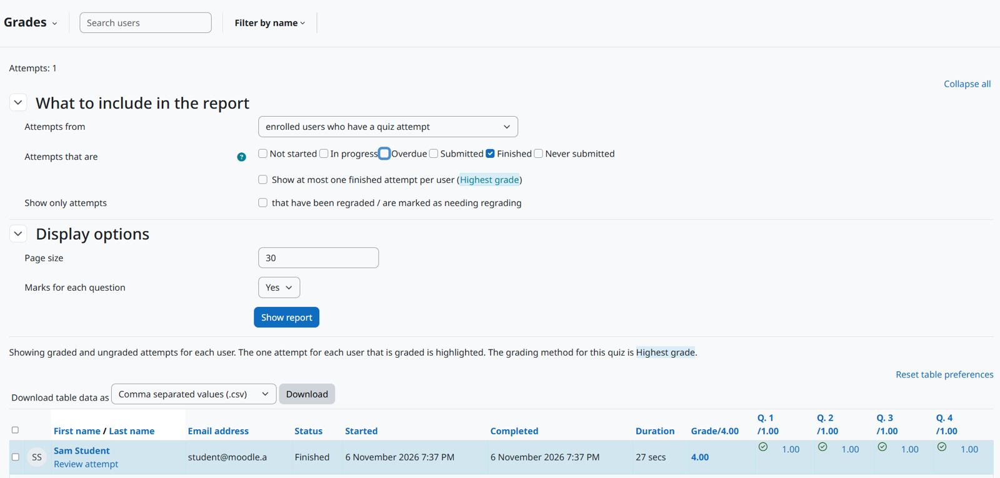
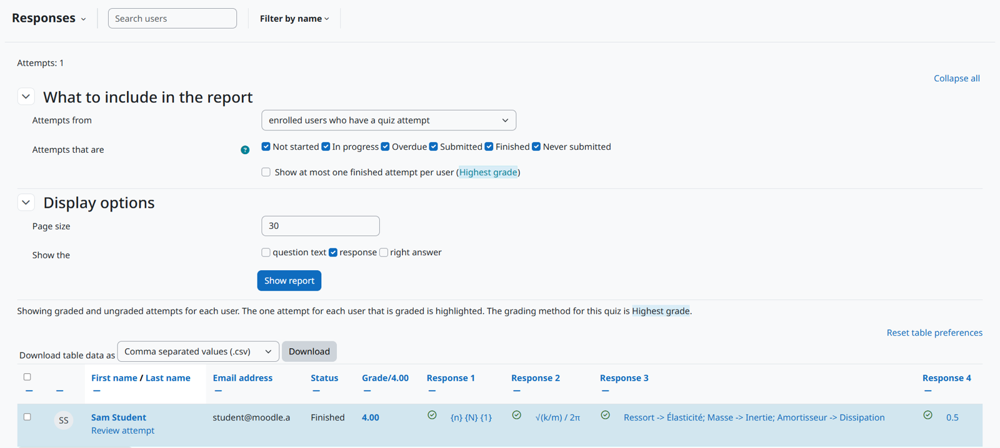
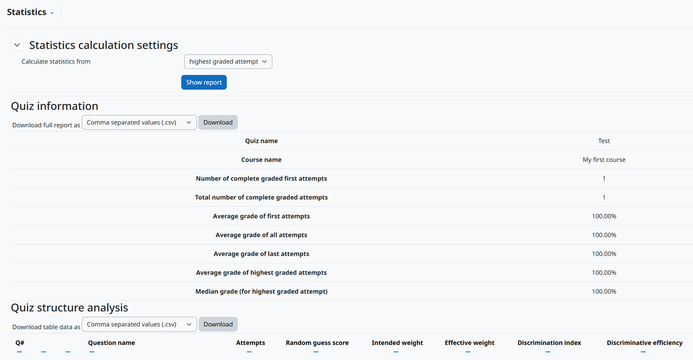
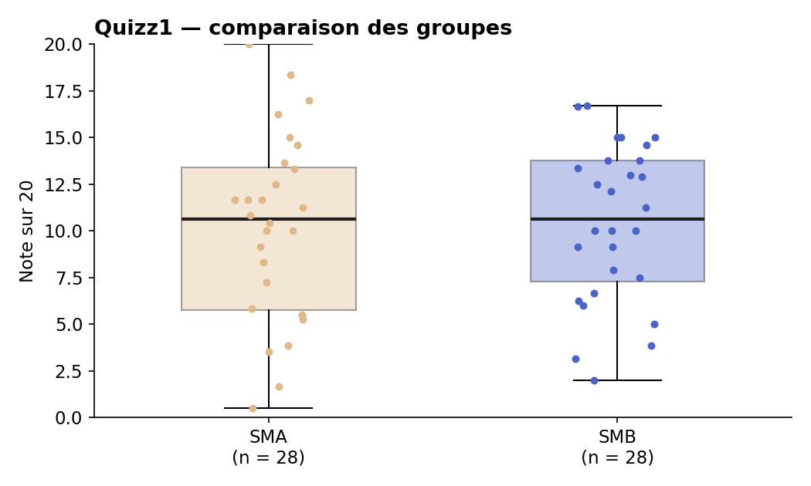
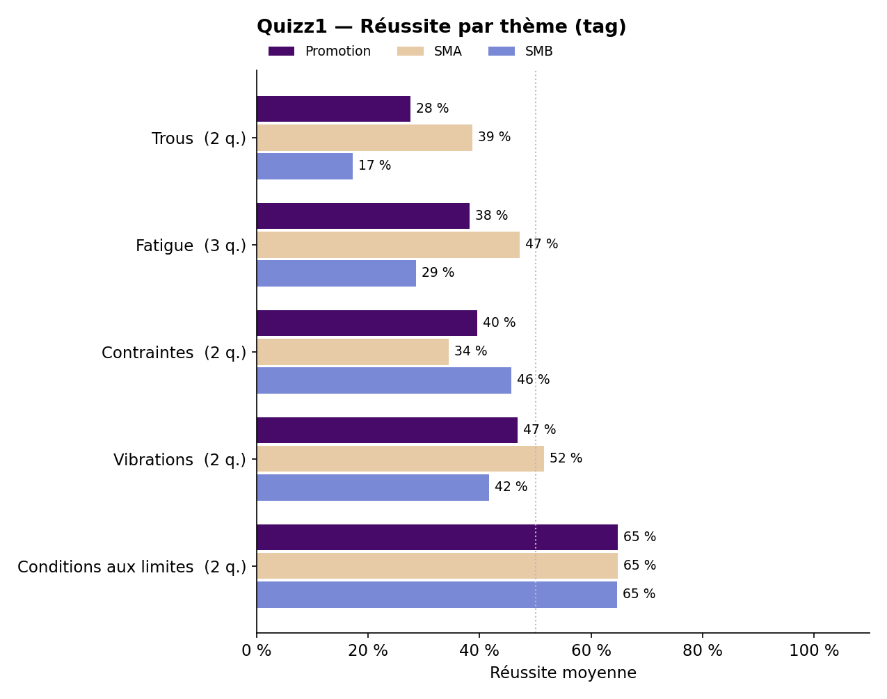
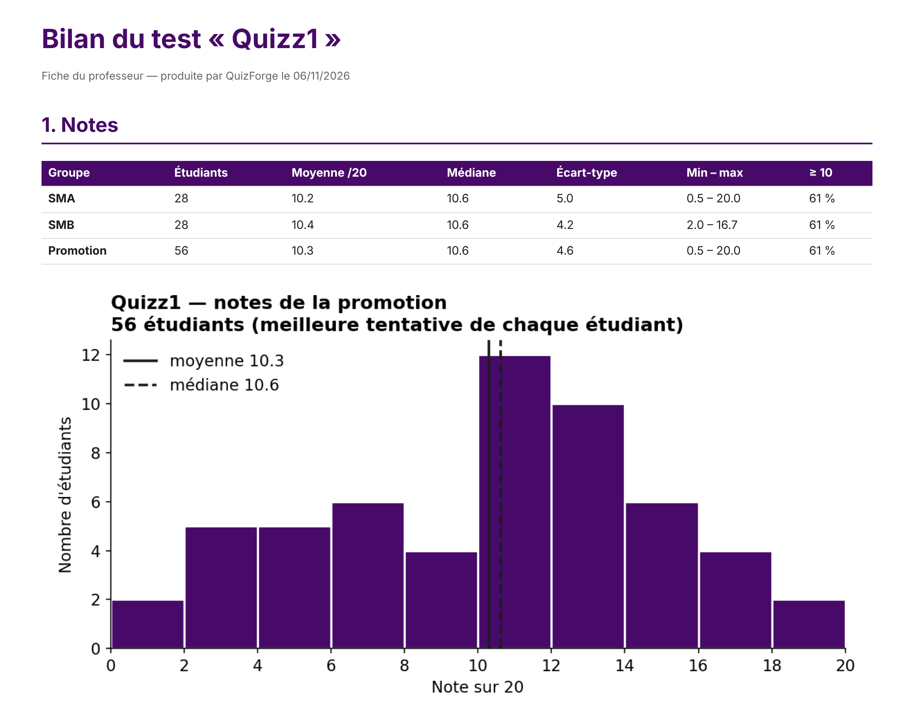
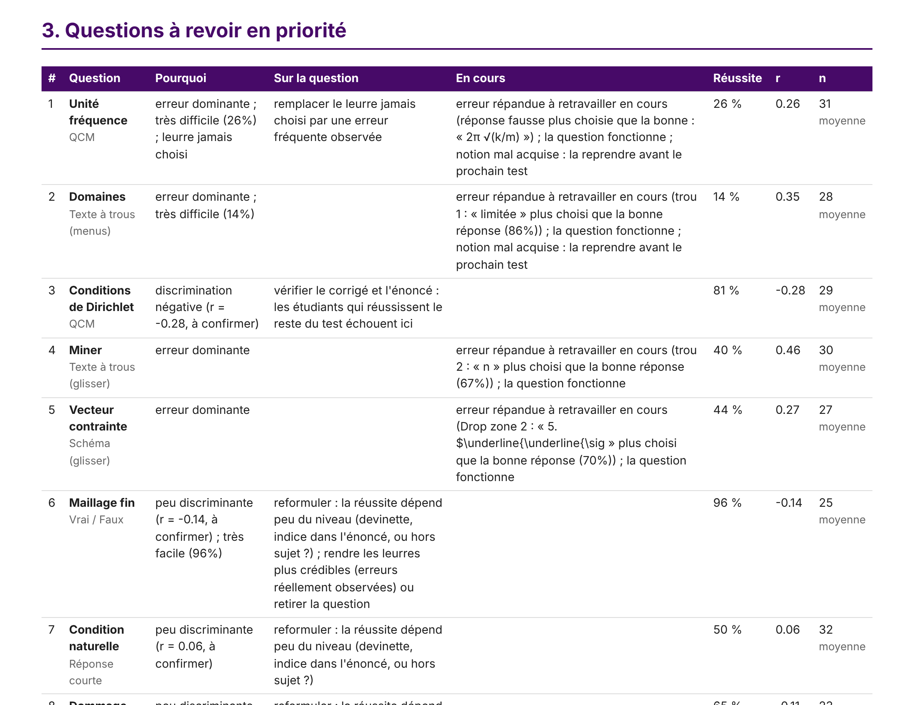

# DiagForge

<p></p>

DiagForge regroupe l'analyse de ce qui a été produit avec les outils Forge : résultats des étudiants, qualité des questions, et à terme des exercices et des quiz eux-mêmes. Cette page décrit la partie disponible aujourd'hui, l'analyse des résultats d'un test Moodle.

## Analyse des résultats d'un test Moodle

Le bilan lit les exports d'un test Moodle et produit, pour le professeur, un classeur d'analyse et une fiche de synthèse, et pour les étudiants, des images anonymes de la répartition des notes et de la réussite par thème. Il désigne les questions à revoir en priorité : celles qui fonctionnent mal (à reformuler) et les notions mal acquises (à retravailler en cours).

La commande est `python scripts/diagforge/diagforge.py` ; elle équivaut à la commande `bilan` de [QuizForge](../quizforge/README.md) (`python scripts/quizforge/quizforge.py bilan`, mêmes options), qui lit le profil d'établissement. Code : [`scripts/diagforge/`](https://github.com/Benoit2lattre/Forge_E-Learning/tree/main/scripts/diagforge) (`bilan.py`, `bilan_sorties.py`, `graphiques.py`, `tirage.py`). Installation : [README du dépôt](https://github.com/Benoit2lattre/Forge_E-Learning#installation) (les images demandent `matplotlib`).

## Essai immédiat, sur une promotion fictive

```bash
python scripts/diagforge/diagforge.py donnees/diagforge/promotion_groupes -p Ecole1
```

Le dossier contient les exports de deux groupes (60 étudiants fictifs), un roster et l'export XML des questions avec leurs tags de thème. Les sorties sont écrites à côté des exports. Les autres jeux d'essai sont décrits dans [`donnees/`](https://github.com/Benoit2lattre/Forge_E-Learning/tree/main/donnees).

## 1. Exporter les résultats depuis Moodle

Dans le test : **Résultats**, puis le rapport voulu, puis « Télécharger les données » au format CSV (ou Excel). Exports en français ou en anglais.

| Export | Obligatoire | Réglage |
| --- | --- | --- |
| **Notes** (`…-grades.csv`) | oui | |
| **Réponses** (`…-responses.csv`) | oui | cocher **Texte de la question** et **Bonne réponse** dans les options d'affichage : indispensable si le test tire des questions au hasard (« Q. 1 » désigne alors une position, pas une question) |
| Questions du test, format Moodle XML | conseillé | donne le nom des questions, leur type, leur nombre d'options, leur catégorie, leurs tags et les leurres peu choisis |
| Banque QuizForge (`<classeur>_banque.yaml`) | non | si les questions viennent de QuizForge avec des `Code erreur n` : erreurs types visées par chaque leurre (onglet « Par erreur ») |
| Statistiques | non | les indicateurs sont recalculés ; s'il est présent, son résumé est affiché à côté pour comparaison |

| Notes | Réponses (options d'affichage) |
| --- | --- |
|  |  |
| **Questions (XML)** | **Statistiques** |
|  |  |

**Pourquoi CSV plutôt que JSON ?** Moodle construit les clés JSON en ne gardant que lettres et chiffres : « Q. 1 /1.00 » devient `q1100`, et `q10200` peut se lire « question 10 sur 2,00 » ou « question 1 sur 0,200 ». Quand un export plante (Statistiques), Moodle ajoute sa page d'erreur au fichier : le JSON devient illisible, alors que le début d'un CSV reste exploitable. Un CSV s'ouvre aussi dans Excel pour vérifier un export.

## 2. Lancer le bilan

Rangez les exports d'un test dans un dossier (vos vrais exports dans `data/diagforge/<test>/`, qui n'est pas publié), puis :

```bash
python scripts/diagforge/diagforge.py data/diagforge/Quizz1
python scripts/diagforge/diagforge.py data/diagforge/Quizz1 -r roster.csv -t premiere
```

| Option | Rôle |
| --- | --- |
| `-r roster.csv` | liste des étudiants avec une colonne `Groupe` (et Nom, Prénom ou Courriel) ; aussi trouvé tout seul s'il est dans le dossier |
| `-t` | tentatives prises en compte : `toutes` (défaut), `premiere`, `derniere`, `meilleure` |
| `-q fichier.xml` | export XML des questions rangé ailleurs |
| `-p` | profil : couleurs des images et de la fiche |
| `-s` | nom du classeur produit |
| `--sans-images` | pas d'images PNG |
| `--cours stat:epf-mae` | profil de l'école de l'édition (cours de l'Atelier Forge), si `-p` n'est pas donné |

**Version du quiz.** Le bilan cherche, d'après les noms des questions de l'export XML, la version QuizForge du test dans les registres des cours (ceux de l'édition avec `--cours`, sinon tous) : il l'écrit dans un onglet « Version » du classeur (avec les questions absentes ou en plus) et inscrit le bilan au registre (état « bilan fait », liens vers le classeur et la fiche).

**Groupes.** Le roster est prioritaire ; les étudiants absents du roster sont signalés. Sans roster, un test par groupe dont le nom se termine par le groupe suffit : les exports `<cours>-Quizz1_SMA-…` et `<cours>-Quizz1_SMB-…` sont réunis sous « Quizz1 », groupes SMA et SMB.

**Thèmes.** Tags, types et catégories viennent de l'export XML. Les tags présents sur presque toutes les questions, ou identiques à un type, sont ignorés. Pour des thèmes utiles, ajoutez-les dans le classeur QuizForge (colonne `Tags` ou ligne `$TAGS:`, voir [QuizForge](../quizforge/README.md#tags)).

## 3. Ce que produit le bilan

### Pour les étudiants : `bilan_<test>_images/`

Images anonymes à déposer dans Moodle : `notes_promotion.png` (histogramme sur 20, moyenne, médiane, meilleure tentative de chaque étudiant), `notes_groupe_<g>.png`, `notes_par_groupe.png`, `reussite_par_tag.png`, `reussite_par_type.png`, `reussite_par_categorie.png`.

| Notes par groupe | Réussite par thème |
| --- | --- |
|  |  |

### Pour le professeur : `bilan_<test>_fiche_prof.html`

Fiche à ouvrir dans le navigateur (et à imprimer en PDF) : notes par groupe, où se produisent les erreurs (par thème, par type, détail par question), questions à revoir en priorité, indicateurs du test.

| Notes | Questions à revoir |
| --- | --- |
|  |  |

Chaque question à revoir indique **pourquoi** (erreur dominante, trop facile ou trop difficile, peu discriminante, leurre non fonctionnel ou choisi par de bons étudiants…), **ce qu'il faut changer dans la question** et **ce qu'il faut retravailler en cours**, avec la réussite, la discrimination `r` et le nombre de réponses `n`.

### Le classeur `bilan_<test>.xlsx`

| Onglet | Contenu |
| --- | --- |
| Synthèse | tentatives, note moyenne et médiane (et sur 20), répartition, indicateurs du test calculés comme Moodle (écart-type, asymétrie, aplatissement, cohérence interne, ratio d'erreur, erreur type), questions à surveiller |
| À revoir | questions classées : rang, pourquoi, ce qu'il faut changer, ce qu'il faut retravailler, confiance |
| Questions | réussite moyenne, part entièrement juste, discrimination, réponse fausse la plus fréquente, alertes |
| Groupes, Par tag, Par type, Par catégorie | réussite moyenne de la promotion et de chaque groupe |
| Réponses | toutes les réponses données, regroupées (ordre des paires et des cases cochées ignoré) |
| Éléments | détail des réponses composées : paires d'appariement, zones d'un schéma, trous, cases cochées |
| Étudiants | tentatives, première, dernière et meilleure note, copies à corriger, tentatives très rapides et faibles |
| Tentatives | notes et réponses réunies, une ligne par tentative |
| Par erreur | si la banque QuizForge donne des erreurs types : pour chaque erreur, questions qui la visent, part des réponses qui la trahissent, étudiants qui la font, et sur au moins deux questions (un diagnostic sur une seule question est fragile, [klingbeil2024](../../reference/H_specificites_stem/klingbeil2024.md)) |

## Tirage des questions, équité et rétention

Le bilan regarde comment les questions ont été tirées (bloc `quiz` du profil QuizForge, voir [QuizForge](../quizforge/README.md#quiz-de-séance-avec-rappels-séance)) :

- **Mode observé** pour chaque test (les groupes `Quizz1_SMA`, `Quizz1_SMB` sont réunis) : `commun` si toutes les tentatives contiennent les mêmes questions, `mixte` si les questions de la séance sont communes et les rappels des séances précédentes tirés, `partiel` sinon. Le mode est comparé à `quiz.tirage` du profil : un écart signale une section oubliée ou mal réglée dans Moodle. La séance d'une question vient de son tag `S01`, `S02`… (colonne `Séance` de QuizForge).
- **Équité du tirage** (onglet « Tirage ») : pour les questions tirées d'une même catégorie et d'une même séance, réussite la plus basse et la plus haute. Au-delà de 30 points d'écart, deux étudiants n'ont pas eu un quiz de même difficulté : rééquilibrer ou scinder la catégorie. Seuil d'usage (aucune fiche de la bibliographie ne porte sur ce point).
- **Rétention** (onglet « Rétention ») : en donnant au bilan les exports de plusieurs séances (plusieurs dossiers, ou un dossier qui les contient), chaque question est comparée entre le jour de sa séance et ses passages en rappel dans les quiz suivants ([yang2021](../../reference/A_tests_retroaction/yang2021.md), [murray2025](../../reference/A_tests_retroaction/murray2025.md)). Les onglets Questions et À revoir mélangent alors les séances : lire la qualité des questions sur le bilan de chaque quiz.
- Onglet Questions : colonnes « Séance » et « Bloc » (séance, rappel).

## Lire les indicateurs avec prudence

Les seuils viennent de la bibliographie de l'axe C ([analyse d'items](../../reference/C_analyse_items/README.md)) : ce sont des règles d'usage, et toutes les alertes sont des points à vérifier par l'enseignant, pas des verdicts.

| Indicateur | Lecture | Source |
| --- | --- | --- |
| **Discrimination** `r` (corrélation entre la question et le reste du test, question exclue) | négative : à revoir (corrigé, énoncé ambigu ?) ; sous 0,15 : faible ; 0,15 à 0,35 : correcte ; au-dessus de 0,35 : très bonne (colonne « Lecture de r ») | Slepkov et al. (2021) |
| Discrimination d'une question réussie à moins de 30 % ou à plus de 90 % | « peu fiable » : l'indice y sous-estime la discrimination réelle, on n'en tire ni alerte ni priorité | MacDonald et Paunonen (2002) |
| Moins d'une cinquantaine de réponses | discrimination « à confirmer » ; pas de calcul sous 20 réponses | |
| **Très difficile** | réussite sous environ le hasard + 0,10 : 0,43 à 3 options, 0,35 à 4, 0,30 à 5 (0,60 pour un vrai/faux, par extension) ; 0,30 pour les autres types | Slepkov et al. (2021) |
| **Très facile** | réussite au-dessus de 0,90 | |
| **Réponse fausse plus choisie, ou autant choisie, que la bonne** | alerte prioritaire ; aussi pour chaque trou, zone ou paire | Srisomsak et al. (2026) |
| **Score des leurres** (onglet Réponses) | score moyen au reste du test de ceux qui choisissent chaque réponse, et écart avec ceux qui ont juste ; alerte si un leurre attire des étudiants aussi forts que ceux qui ont juste (clé fausse, deuxième bonne réponse ?) | Attali et Fraenkel (2000) |
| **Leurre non fonctionnel** | choisi par moins de 0,1 × (1 − réussite) des étudiants ; seulement si au moins 10 étudiants se trompent et si la réussite ne dépasse pas 90 % | Raymond et al. (2019) |
| **Cohérence interne (alpha)** | affichée avec le nombre de questions par tentative, la valeur typique pour ce nombre de questions, la corrélation moyenne entre questions, l'alpha ramené à 50 questions et l'alpha par thème ; pas de verdict à 0,70, et ne retirez pas une question pertinente pour le faire monter | Edelsbrunner et al. (2025), Taber (2018) |

- Quand le test tire les questions au hasard, l'alpha est calculé sur les positions et l'alpha par thème n'est calculable que si des tentatives contiennent toutes les questions du thème.
- Les copies « à corriger » (questions ouvertes) sont signalées et exclues du calcul de la discrimination.
- Une question très réussie par tous n'est pas forcément mauvaise : en début de cours, elle peut servir à rassurer.

## Tester sans vraie promotion

```bash
python scripts/diagforge/outils/promotion_fictive.py <export_reponses.csv> <questions.xml> --fr -g "SMA;SMB"
```

Fabrique 60 étudiants fictifs au format des exports Moodle, avec des cas connus listés dans `verite.txt` (question trop facile, leurre jamais choisi, erreur dominante…), pour vérifier que le bilan les retrouve.
