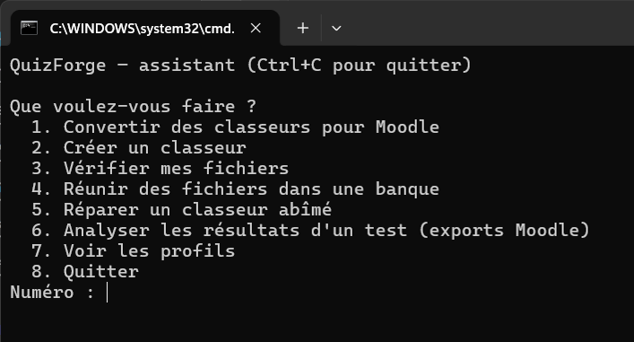
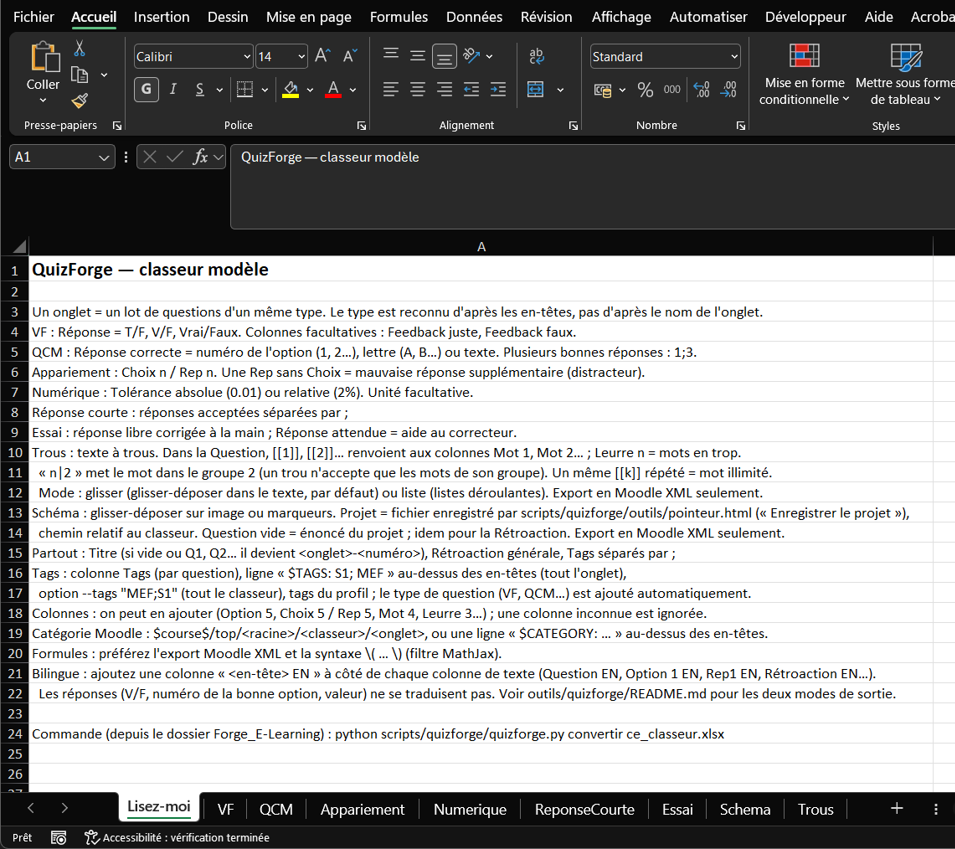
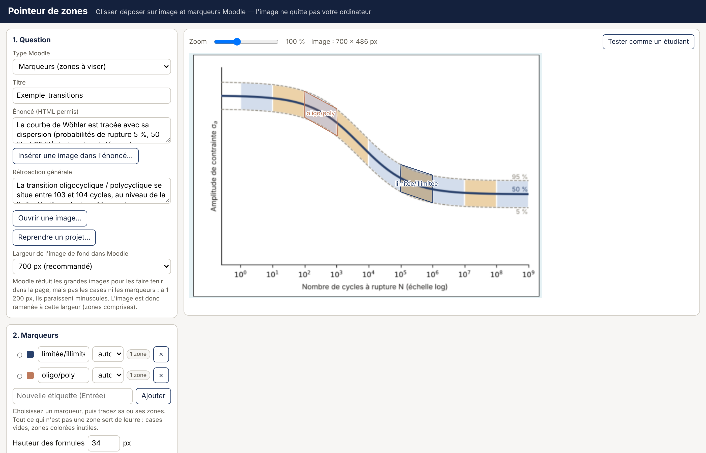
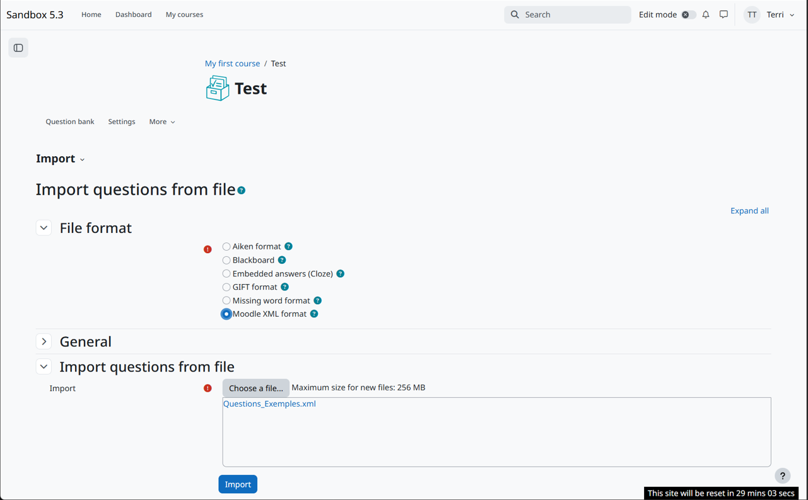
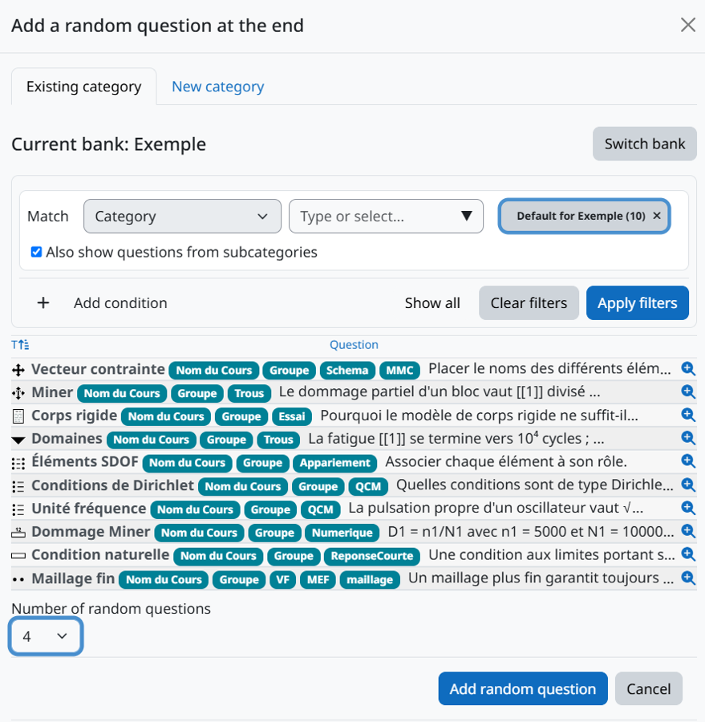
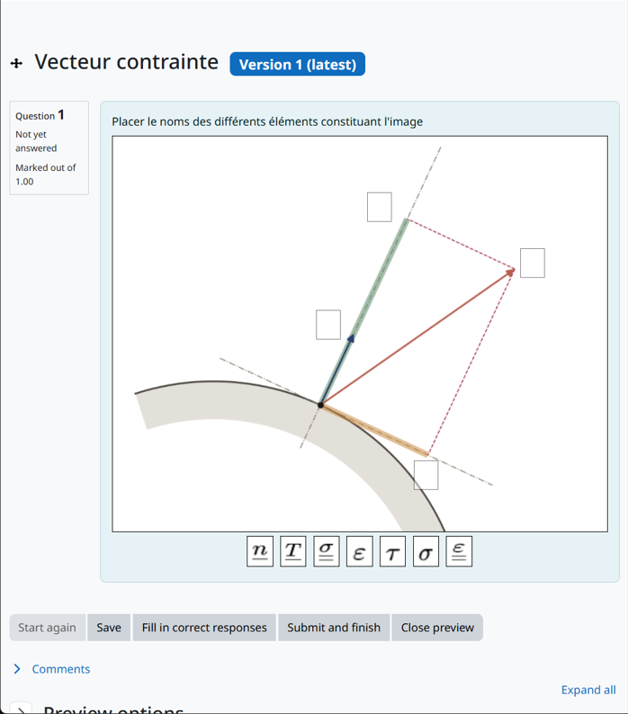

# QuizForge

<p></p>

QuizForge convertit des classeurs Excel (et d'anciens fichiers GIFT) en questions prêtes à importer dans Moodle : fichier Moodle XML, fichiers GIFT (aussi lus par ActivePresenter) et banque YAML lisible. Il prépare aussi les questions sur image (glisser-déposer, marqueurs) et analyse les résultats d'un test (voir [DiagForge](../diagforge/README.md)).

Code : [`scripts/quizforge/`](https://github.com/Benoit2lattre/Forge_E-Learning/tree/main/scripts/quizforge). Installation : [README du dépôt](https://github.com/Benoit2lattre/Forge_E-Learning#installation).

## En 3 minutes

```bash
# 1. un classeur d'exemple : un onglet par type de question
python scripts/quizforge/quizforge.py modele -s mon_quiz
# 2. le remplir dans Excel, puis le vérifier et le convertir
python scripts/quizforge/quizforge.py valider mon_quiz.xlsx
python scripts/quizforge/quizforge.py convertir mon_quiz.xlsx -p Ecole1
```

`convertir` crée à côté du classeur un dossier `mon_quiz_QuizForge/` :

| Fichier | Usage |
| --- | --- |
| `mon_quiz_moodle_FR.xml` | à importer dans Moodle : à préférer, il porte les rétroactions par réponse, les unités, les tags, le barème et la mise en forme du profil |
| `<onglet>_FR.gift.txt` | un fichier GIFT par onglet, importable dans Moodle et dans ActivePresenter |
| `mon_quiz_banque.yaml` | les questions dans un format texte lisible |
| `rapport.txt` | questions lues, lignes ignorées et pourquoi |

Le suffixe `_FR` est la langue : le classeur modèle est bilingue, il produit aussi les fichiers `_EN` (voir [Questions bilingues](#questions-bilingues-fr--en)). Ses deux lignes d'exemple de l'onglet Schéma renvoient à des projets du pointeur rangés avec les exemples ([`exemples/wohler/exemple_classeur/`](https://github.com/Benoit2lattre/Forge_E-Learning/tree/main/outils/quizforge/exemples/wohler/exemple_classeur)) : ailleurs, `valider` les signale comme introuvables et elles sont ignorées.

Sous Windows, `scripts/quizforge/QuizForge.bat` évite la ligne de commande :



- **double-clic** : assistant pas à pas (menus numérotés : action, classeur, profil, tags, formats). Lancé depuis le dépôt, il propose vos classeurs de `data/quizforge/` et les exemples. La commande équivalente est affichée avant d'être lancée, pour la retrouver la fois suivante ;
- **glisser un ou plusieurs classeurs sur le fichier** : conversion avec le profil par défaut.

## Commandes

| Commande | Rôle |
| --- | --- |
| `convertir <classeurs…>` | classeurs Excel ou fichiers GIFT vers Moodle XML, GIFT, banque YAML |
| `valider [dossier ou fichier]` | vérifie classeurs, projets du pointeur et profils, sans rien écrire |
| `modele` | crée `modele_QuizForge.xlsx` (un onglet exemple par type) ; `-v` : en-têtes seuls ; `-o "VF;QCM"` : seulement ces onglets ; `--ecraser` pour remplacer un classeur existant |
| `importer <dossier>` | réunit des fichiers Excel / GIFT existants dans une banque unique, dédoublonnée (`-b banque`, `-x` : aussi en XML) |
| `fusionner FR.xlsx EN.xlsx` | réunit un classeur et sa traduction en un classeur bilingue |
| `reparer <classeur>` | écrit une copie corrigée d'un classeur abîmé par un Rechercher/Remplacer « V » → « T » (« plusFin », « deTon Mises ») |
| `profils [nom]` | liste les profils, ou affiche les réglages d'un profil |
| `bilan <dossier>` | analyse les exports Moodle d'un test : voir [DiagForge](../diagforge/README.md) |
| `assistant` | menus pas à pas (ce que lance le double-clic sur `QuizForge.bat`) |

Options courantes : `-p` profil, `-t "MEF;S1"` tags, `-s` sortie, `-f xml;gift` formats, `-l separe|multilang` langues, `-r` réparer les textes abîmés, `-n` nom de la catégorie, `-c` racine de catégorie.

**Saisie tolérante.** La première lettre d'une commande suffit (`c`, `con`, `-c`, `C` = convertir). Pour les noms courts (onglets, profils, formats, langues, types), la première lettre suffit aussi, sans accents ni majuscules : `schéma`, `S` → Schema ; `QMC` → QCM ; `-p d` → Delattre. L'extension d'un fichier peut être omise ou mal tapée (`MEF_P2026.slxs` → `MEF_P2026.xlsx`). Chaque interprétation est affichée (« Compris : onglet « QMC » → QCM ») ; si rien ne correspond, les valeurs possibles sont listées.

## Le classeur Excel

Le type de chaque onglet est reconnu d'après ses en-têtes de colonnes. Un en-tête proche d'un en-tête connu (`Qeustion`, `Répnse`) est accepté avec une ligne dans le rapport ; une colonne non reconnue est ignorée (pratique pour vos remarques).

| Type | Colonnes obligatoires | Colonnes facultatives |
| --- | --- | --- |
| Vrai/Faux | Question, Réponse (T/F, V/F, Vrai/Faux) | Feedback juste, Feedback faux |
| QCM | Question, Réponse correcte (1, A, texte ; plusieurs : 1;3), Option 1… | Feedback 1…, Code erreur 1… (voir plus bas) |
| Appariement | Question, Choix1/Rep1, Choix2/Rep2… (Rep sans Choix = distracteur) | |
| Numérique | Question, Valeur | Tolérance (0.01 ou 2%), Unité, Feedback juste, Erreur 1… et Feedback erreur 1…, Feedback faux (voir plus bas) |
| Réponse courte | Question, Réponses acceptées (séparées par ;) | Casse |
| Essai | Question | Réponse attendue (aide au correcteur) |
| Schéma (glisser-déposer sur image, marqueurs) | Question, Projet | Rétroaction |
| Texte à trous | Question (avec [[1]], [[2]]…), Mot 1, Mot 2… | Leurre 1…, Mode (glisser / liste) |



Communes à tous : `Num`, `Titre` (vide ou Q1, Q2… → `<onglet>-<numéro>`), `Rétroaction` (rétroaction générale), `Tags` (séparés par `;`). On ajoute autant de colonnes numérotées que nécessaire (`Option 5`, `Feedback 5`, `Choix5` / `Rep5`, `Mot 4`, `Leurre 3`…). Colonnes facultatives `Indice 1`, `Indice 2`… (tous les types sauf Schéma et Texte à trous) : indices montrés entre deux essais quand le test Moodle est en mode « interactif avec plusieurs essais » ; XML seulement ([schwerter2022](../../reference/A_tests_retroaction/schwerter2022.md)).

### Quiz de séance avec rappels (`Séance`)

Un quiz court après chaque séance, qui fait revenir des questions des séances précédentes, est l'une des pratiques les mieux établies ([yang2021](../../reference/A_tests_retroaction/yang2021.md), niveau A ; à vérifier en mathématiques, [murray2025](../../reference/A_tests_retroaction/murray2025.md)).

- Colonne `Séance` (tous les types) ou ligne `$SEANCE: 3` en tête d'onglet : numéro de la séance où la notion est vue. Chaque question reçoit le tag `S03`, qui sert de filtre aux questions aléatoires de Moodle. Rien n'est recopié dans la banque.
- `convertir mon_quiz.xlsx --seance 3 [--etudiants 60]` écrit en plus `mon_quiz_plan_S03.md`, le plan du quiz : une section par catégorie de la séance 3, puis une section de rappels par séance précédente (filtre `S01`, `S02`… sur la catégorie commune, sous-catégories comprises), avec le nombre de questions à tirer ; le score au hasard et le seuil du quiz **tel qu'il sera tiré** ; avec `--etudiants`, le nombre de réponses attendu par question (sous 20, DiagForge ne calcule pas la discrimination).
- Le bloc `quiz` du profil règle le tirage :

| `quiz.tirage` | Questions de la séance | Rappels | Usage |
| --- | --- | --- | --- |
| `partiel` (défaut) | k tirées sur N par catégorie : N × `part_tiree` (0,33), au moins 1, au plus `max_tire` (10) | tirées au hasard | quiz en classe, étudiants proches et peu surveillés : limite les échanges de réponses |
| `commun` | toutes, dans un ordre mélangé | mêmes questions pour tous, listées dans le plan (tirées une fois, `--graine`) | toutes les réponses pour chaque question : analyse la plus complète |
| `mixte` | toutes, dans un ordre mélangé | tirées au hasard | séance analysée complètement, rappels variés |

`quiz.rappel` (0,3, ou `--rappel`) donne la part des rappels dans le quiz. Ces modes ne changent pas le XML : ils changent le plan et la lecture des résultats par DiagForge. Aucune fiche de notre bibliographie ne porte sur le tirage pour limiter les échanges ni sur l'équité entre versions tirées : ce sont des choix d'usage.

### Erreurs types visées par les leurres (`Code erreur n`)

Un bon leurre est une erreur réellement commise par les étudiants, nommée ([steif2006](../../reference/H_specificites_stem/steif2006.md), [gierl2017](../../reference/C_analyse_items/gierl2017.md)). À côté de `Option n` (QCM) ou de `Erreur n` (Numérique), la colonne `Code erreur n` donne le nom court de l'erreur visée : « rapport inversé », « pulsation pour fréquence », « force interne dans le DCL ». Écrivez-le toujours de la même façon d'une question à l'autre : c'est ce qui permet de suivre une erreur sur plusieurs questions.

- Le code est gardé dans la banque YAML (`<classeur>_banque.yaml`), pas dans le XML Moodle.
- DiagForge le lit si la banque est rangée avec les exports Moodle (ou donnée par `-q`) : colonne « Erreur type » de l'onglet Réponses, onglet « Par erreur » (part des réponses qui trahissent chaque erreur, étudiants qui la font sur au moins deux questions) et ligne « Erreurs types les plus fréquentes » de la synthèse. Voir [DiagForge](../diagforge/README.md).
- `valider` signale un leurre sans erreur type dans une question qui en a d'autres, un code sur une bonne réponse, deux leurres pour la même erreur (QCM à une réponse) et un même code écrit de plusieurs façons. Une quatrième option n'est plus signalée si chaque leurre vise une erreur nommée.

### Onglet « Numérique » : erreurs types

Une réponse numérique fausse dit souvent quelle erreur a été faite : rapport inversé, facteur oublié, mauvaise unité, sinus au lieu du cosinus. Pour chaque erreur type, `Erreur n` donne la valeur obtenue avec cette erreur et `Feedback erreur n` le retour qui la nomme ; la tolérance est celle de la bonne réponse (relative si elle est donnée en %). `Feedback juste` est le retour de la bonne réponse, `Feedback faux` celui de toute autre valeur (réponse `*` de Moodle, XML seulement). Moodle retient la première réponse dont l'intervalle contient la saisie : la bonne réponse est écrite en premier, puis les erreurs types.

| Valeur | Tolérance | Feedback juste | Erreur 1 | Feedback erreur 1 | Feedback faux | Indice 1 |
| --- | --- | --- | --- | --- | --- | --- |
| 0.5 | 2% | Exact. | 2 | Rapport inversé : le dommage vaut n/N, pas N/n. | Reprenez la définition du dommage partiel. | Le dommage est compris entre 0 et 1. |

`valider` signale une erreur type qui tombe dans la tolérance de la bonne réponse (elle ne serait jamais reconnue, et l'erreur donnerait la note : changer les données de l'énoncé), deux erreurs types confondues et une erreur type sans retour ([sikurajapathi2023](../../reference/H_specificites_stem/sikurajapathi2023.md), [gill2008](../../reference/H_specificites_stem/gill2008.md)). Les valeurs des erreurs types se calculent à la main ou dans un tableur : les questions à données tirées au hasard relèvent d'ExoForge.

### Onglet « Schéma » : questions sur image

Les questions glisser-déposer sur image et à marqueurs se préparent dans le **pointeur**, une page à ouvrir dans le navigateur : [`scripts/quizforge/outils/pointeur.html`](../../scripts/quizforge/outils/pointeur.html). L'image ne quitte pas votre ordinateur.



1. « Ouvrir une image… », choisir le type Moodle (glisser-déposer ou marqueurs) et la largeur (700 px recommandés : Moodle réduit les grandes images mais pas les zones).
2. Ajouter les étiquettes (texte, image ou formule `$…$`), puis tracer leurs zones ; tout ce qui n'est pas une zone sert de leurre.
3. « Tester comme un étudiant », puis « Enregistrer le projet » : fichier `…_pointeur.json`.

Dans le classeur, un onglet avec les colonnes `Titre`, `Question`, `Projet`, `Rétroaction`, `Tags`, une ligne par question :

- `Projet` : le fichier du pointeur, chemin relatif au classeur (ex. `schemas/rainflow_pointeur.json`) ;
- `Question` vide : énoncé saisi dans le pointeur. Un énoncé écrit dans Excel le remplace, en gardant les images insérées dans le pointeur ;
- `Rétroaction` vide : celle du pointeur.

Export en Moodle XML seulement (le GIFT ne sait pas décrire ces questions). Les étiquettes ne se traduisent pas : pour une version anglaise, faites un second projet.

### Onglet « Texte à trous »

Dans la `Question`, `[[1]]`, `[[2]]`… marquent les trous ; chaque numéro renvoie à la colonne `Mot` du même numéro. Les colonnes `Leurre 1`, `Leurre 2`… ajoutent des mots en trop.

- `n|2` : le mot va dans le groupe 2. Un trou n'accepte que les mots de son groupe (une couleur dans Moodle), par exemple pour séparer les symboles des valeurs. Sans `|`, groupe 1.
- Un même `[[k]]` répété : le mot est proposé en nombre illimité.
- `Mode` : `glisser` (défaut) ou `liste` (listes déroulantes).
- Export en Moodle XML seulement.

### Questions bilingues (FR / EN)

À côté de chaque colonne de texte, ajoutez sa traduction avec le suffixe de langue : `Question EN`, `Option 1 EN`, `Rétroaction EN`… Les colonnes de réponse (V/F, numéro de la bonne option, valeur) valent pour les deux langues. Une case de traduction vide reste vide.

- `-l separe` (défaut) : une version par langue, dans des catégories `FR/…` et `EN/…` (fichiers `_FR` et `_EN`). Fonctionne sur tout Moodle.
- `-l multilang` : une seule question contenant les deux langues ; Moodle affiche celle de l'étudiant. Nécessite le filtre « Contenu multilingue » activé par l'administrateur.

`fusionner Stat_Quizz2.xlsx Stat_Quizz2_EN.xlsx` produit `Stat_Quizz2_bilingue.xlsx` ; le rapport signale les réponses qui diffèrent entre les deux langues.

## Catégories Moodle

À l'import, Moodle crée l'arborescence `<racine (-c)> / <nom du classeur> / <nom de l'onglet>`. Exemple : `convertir MEF_P2026.xlsx -c MEF` → `MEF/MEF_P2026/Vrai_Faux`, `MEF/MEF_P2026/Appariement`.

- Un onglet = une sous-catégorie : un seul import suffit.
- **Renommer le classeur crée une nouvelle catégorie** (`MEF_P2026_corrige.xlsx` → `MEF_P2026_corrige`). Pour garder la même : `-n MEF_P2026`.
- Réimporter le même classeur ajoute les questions une seconde fois : Moodle ne remplace pas.
- Une ligne `$CATEGORY: …` au-dessus des en-têtes d'un onglet impose sa catégorie.

## Tags

Moodle peut tirer des questions aléatoires filtrées par tags. Chaque question reçoit, sans doublon :

1. les tags fixes du profil (`tags.fixes`) ;
2. ceux de `-t "MEF;S1"` (tout le classeur) ;
3. ceux d'une ligne `$TAGS: Fatigue; chapitre 2` au-dessus des en-têtes d'un onglet ;
4. les tags automatiques du profil (`tags.automatiques`) : `type` (VF, QCM, Appariement, Numerique, ReponseCourte, Essai, Schema, Trous), `onglet`, `classeur` ;
5. ceux de la colonne `Tags`.

Les tags de thème servent aussi à [DiagForge](../diagforge/README.md) (réussite par thème). Moodle ne distingue pas les majuscules ; les tags ne passent que par le XML.

## Profils

Un profil regroupe les réglages d'un établissement : langues, formats produits, types autorisés, barème (note, pénalité par essai, numérotation et mélange des QCM, options fausses des QCM à plusieurs réponses : `negative`, `equilibree` ou `zero`), tags, charte (couleurs, polices, encadré de la rétroaction générale dans le XML). Les options de la ligne de commande l'emportent sur le profil.

Profils fournis : `Delattre` (défaut) et `Ecole1` (établissement d'exemple). Pour créer le vôtre et pour la liste des rôles de couleur : [profils/](../../profils/README.md) et [style/](../../style/README.md).

Le barème et l'encadré ne passent que par le XML : avec le GIFT, Moodle applique ses valeurs par défaut.

### Barème, score au hasard et seuil de réussite

Le rapport de `convertir` (et `rapport.txt`) donne, par onglet et pour tout le classeur, le **score moyen obtenu en répondant au hasard** et le **score moyen d'un étudiant qui connaît la moitié de la matière**, c'est-à-dire le seuil de réussite qui correspond à « la moitié des connaissances » ([kanzow2023](../../reference/B_conception_qcm/kanzow2023.md), [schmidt2021](../../reference/B_conception_qcm/schmidt2021.md), [schmidt2022](../../reference/B_conception_qcm/schmidt2022.md)). Le seuil est calculé pour un test qui reprend toutes les questions du classeur avec le même poids.

| Question | Au hasard | Seuil pour la moitié des connaissances |
| --- | --- | --- |
| vrai/faux | 50 % | 75 % |
| QCM à une réponse, n options (1 ou 0) | 1/n : 33 % (3 options), 25 % (4) | 50 % + 50 %/n : 67 % (3), 62,5 % (4), 60 % (5) |
| appariement, m réponses proposées | 1/m | 50 % + 50 %/m |
| QCM à plusieurs réponses | selon `mauvaise_option` (tableau suivant) | |
| numérique, réponse courte, trous, essai | proche de 0 | 50 % |

Pour les QCM à plusieurs réponses (t bonnes réponses sur n options), `bareme.qcm.mauvaise_option` du profil règle ce que retire une mauvaise case cochée ; une bonne case rapporte 1/t, et Moodle ramène la note de la question entre 0 et 1.

| `mauvaise_option` | Mauvaise case | Cocher toutes les cases | Au hasard / moitié des connaissances (exemples) |
| --- | --- | --- | --- |
| `negative` (défaut) | −1/t | 0 si t ≤ n/2, sinon des points (33 % pour 3 bonnes sur 5) | 4 options, 1 bonne : 6 % / 32 % ; 5 options, 3 bonnes : 24 % / 59 % |
| `equilibree` | −1/(n−t) | toujours 0 | 16 à 25 % / 51 à 56 % quelle que soit la répartition |
| `zero` (déconseillé) | 0 | 100 % | 50 % / 75 % |

`valider` signale une question à plusieurs réponses où cocher toutes les cases rapporte des points. Les autres règles de l'axe B : ne pas annoncer par défaut le nombre de bonnes réponses ([schmidt2022](../../reference/B_conception_qcm/schmidt2022.md)) ; pour un diagnostic, préférer des vrai/faux multiples sur une même situation ([couch2018](../../reference/B_conception_qcm/couch2018.md)) ; avec des points négatifs, annoncer le barème aux étudiants ([lesage2013](../../reference/B_conception_qcm/lesage2013.md)). Le modèle de QCM à une réponse a 3 options.

## Ce que le rapport et `valider` signalent

- onglets ignorés (pas d'en-tête « Question », type non reconnu), en-têtes compris autrement ;
- lignes sans bonne réponse, réponse vrai/faux illisible, trou sans mot, leurre dans un groupe sans trou ;
- textes abîmés par un remplacement « V » → « T » (`-r` pour les réparer) ;
- projets du pointeur : image introuvable, image trop large, zones ou leurres incohérents ;
- profils : clés inconnues, valeurs non comprises, plusieurs profils par défaut ;
- dans les anciens GIFT : `{V}` ou `{Vrai}` (corrigés en TRUE), accolades vides `{}` ;
- doublons entre fichiers, et doublons divergents (même énoncé, réponses différentes).

### Points d'écriture à vérifier (`valider`)

`valider` relit aussi le contenu des questions ([`qualite.py`](../../scripts/quizforge/qualite.py)) et signale, par ordre d'importance, des points à vérifier tirés de la bibliographie ([axe A](../../reference/A_tests_retroaction/README.md), [axe B](../../reference/B_conception_qcm/README.md)). Ce ne sont pas des erreurs : une clé plus longue ou un « toujours » peuvent être voulus.

| Poids | Point signalé | Pourquoi |
| --- | --- | --- |
| `[!!!]` | questions sans rétroaction (ni générale, ni par option, ni juste/faux), regroupées par onglet | un simple « juste / faux » n'apprend presque rien : donner au moins la bonne réponse, de préférence une explication |
| `[!!!]` | clé nettement plus longue que les leurres (1,3 fois la moyenne, options rédigées seulement) ; clé la plus longue dans plus de la moitié des QCM d'un onglet | indice classique : l'étudiant qui choisit la plus longue gagne des points |
| `[!!!]` | options « toutes / aucune des réponses », options combinées (« A et B »), options en double | défauts d'écriture qui faussent la mesure |
| `[!!]` | terme absolu (« toujours », « jamais », « uniquement »…) dans une affirmation vrai/faux ou dans un leurre | il désigne souvent la réponse fausse (sur les banques reprises : 41 affirmations « faux » pour 16 « vrai ») |
| `[!!]` | la clé seule reprend un mot de l'énoncé | indice de la bonne réponse |
| `[!!]` | vrai/faux déséquilibrés (part de « vrai » hors de 35-65 %) | répondre toujours pareil rapporte des points |
| `[!!]` / `[!]` | négation non mise en évidence (« ne … pas », « sauf ») | à mettre en gras ou à reformuler à l'affirmative |
| `[!]` | QCM à une seule bonne réponse et 4 options ou plus ; options numériques hors de l'ordre croissant ; énoncé de QCM sans question ni consigne | 3 options suffisent si la quatrième n'est pas une erreur fréquente (règle établie pour la réponse unique, pas pour les réponses multiples) ; valeurs dans l'ordre |
| `[!]` | bonne réponse souvent à la même position dans un onglet | sans effet pour les étudiants quand les options sont mélangées : `bareme.qcm.melanger` du profil (vrai par défaut) écrit `shuffleanswers` dans le XML, et le test Moodle doit aussi avoir « Mélanger les éléments des questions » ; à corriger pour un import GIFT (qui ne porte pas ce réglage) ou si le mélange est désactivé |

## Exemples ([`exemples/`](https://github.com/Benoit2lattre/Forge_E-Learning/tree/main/outils/quizforge/exemples))

| Dossier | Contenu |
| --- | --- |
| `classeurs/` | `modele_QuizForge.xlsx` (un onglet exemple par type), `vide_QuizForge.xlsx` (en-têtes seuls) |
| `schemas/` | projets du pointeur, images et questions Moodle produites : matrice rainflow, transitions de la courbe de Wöhler, vecteur contrainte ; `Exemple_Matrice_faux_*` : version volontairement fausse pour tester `valider` |
| `wohler/` | schémas de Wöhler générés, questions Moodle, classeur d'essai avec onglet Schéma (`exemple_classeur/`) |
| `vecteur_contrainte/` | script Python qui dessine la figure du vecteur contrainte |

```bash
python scripts/quizforge/quizforge.py convertir outils/quizforge/exemples/wohler/exemple_classeur/Essai_schema.xlsx -p Ecole1
python scripts/quizforge/quizforge.py valider outils/quizforge/exemples/schemas
```

## Importer dans Moodle

Dans le cours : **Banque de questions › Importer**, format **Moodle XML**, puis déposez le fichier `…_moodle_FR.xml`. Les catégories et les tags sont créés à l'import.



Dans un test, **Ajouter › une question aléatoire** tire les questions d'une catégorie, filtrées par tags si besoin :



Une question sur image préparée avec le pointeur, vue par l'étudiant :


